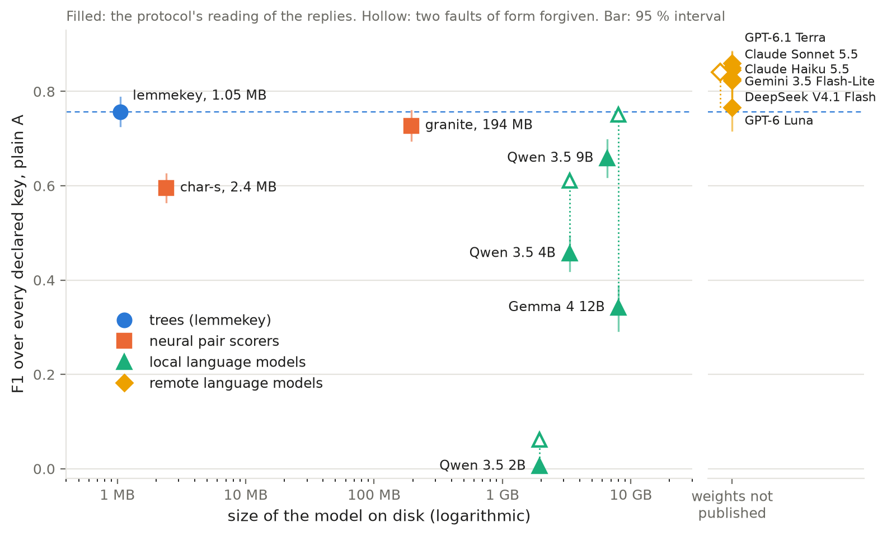

# What stands between a megabyte and a remote language model, 26 November 2026

Round 1z, as [its specification](../round-1z/README.md) set it before
anything was run and logged, entry by entry, while it ran. The key model's
paper argues for a model of about a megabyte against everything larger, and
so far it shows only trees (`eleven--wide`, lemmekey in the paper) against
large remote language models
([keys-paper-model-2026-11-14.md](keys-paper-model-2026-11-14.md)). A
reviewer will ask two things: would a small neural model on the same inputs
do better than trees, and would a local open-weights language model, run on
the user's own machine, close the gap with no remote call?

Both were measured. Part B, four local language models on the two clean
sets, is §1 to §5. Part A, two small networks trained on lemmekey's own
rows, frozen and read once, is §6; it was cut down by the owner from three
networks to two after the machine lost its graphics card on the first
evening. Raw output in
[data/keys-small-models-2026-11-26/](data/keys-small-models-2026-11-26/).

Every F1 is over every declared one-column key, a key right when its column
and its table are; every interval a 95 % percentile interval of 1 000
resamples of schemas (seed 20261101), a difference resampling both arms
together. Plain A (718 GitHub schemas, 16 399 keys) and style 3 (100
schemas, 1 762 keys) are the clean sets of round 1v. For our tree models
they are development data since that round read them, and lemmekey's
figures on them are that one reading's, taken from the counts it kept. For
the local models they are a fair reading: the weights are the publishers'
as downloaded, the prompt is round 1w's unchanged, and each model answered
each schema once. For the networks too: each was frozen by hash before
either set's candidates were built, and read each set once. It is not a
clean comparison in the other direction, since everything written after
round 1v, this round's specification among it, has looked at these sets.

| Question | Answer | What follows |
|---|---|---|
| **Does a local model of 2 to 8 GB beat lemmekey, read as the protocol reads a reply?** | No. On plain A lemmekey reads 0.757 and the four local models 0.005, 0.456, 0.658 and 0.342; lemmekey is above each by 0.099 [0.070, 0.129] at least. On style 3, 0.734 against 0.019, 0.477, 0.689 and 0.480; the nearest, `qwen3.5:9b`, is 0.044 [0.008, 0.076] below | under the paper's protocol the megabyte is above every model a 12 GB card runs |
| **Is that the models, or the form of their replies?** | For two of the four it is the form. Gemma 4 12B writes the target as `users(id)` in 10 557 of its 14 127 false keys on plain A; `qwen3.5:4b` leaves the closing brace off 97 of 718 replies. With those two faults forgiven Gemma reads **0.751** on plain A and 0.746 on style 3, level with lemmekey (lemmekey minus it +0.006 [−0.021, +0.036] and −0.012 [−0.053, +0.021]); `qwen3.5:4b` 0.610; `qwen3.5:9b` is unchanged at 0.658 | the honest sentence for the paper is "level with an 8 GB local model", not "above every local model" |
| **Does the same forgiveness move the remote models?** | One: GPT-6 Luna writes 1 881 targets with their column on plain A, and reads 0.841 forgiven where the protocol read 0.766. The other five move by nothing | the paper's "level with GPT-6 Luna" is an artefact of the reader and has to go (§3) |
| **What does a local model cost?** | 1.9 to 8.0 GB of weights against 1 054 108 bytes; 3.4 to 10.7 GB of the card and about 7 to 11 GB of host memory; a median of 0.2 to 3.4 s a schema and up to five minutes for a large one, on an RTX 5070, against 3 ms on one processor | four to five orders of magnitude in bytes and three in time for the same F1 at best |
| **Where does Gemma stand by the size of a schema?** | Forgiven, above lemmekey at 20 to 99 tables (0.809 and 0.759 against 0.797 and 0.705) and below it under 20 and at 100 or more (0.458 against 0.568): two of the twelve largest schemas were cut and one did not fit its window | recall 0.843 against 0.741, precision 0.677 against 0.774: the remote models' profile at a lower precision |
| **Does reasoning help the small ones?** | Not measured as F1. On the pilot `qwen3.5:2b` at its default reasoning filled its window on all 6 prompts and answered none (about 64 s each); `qwen3.5:4b` on 2 of 4. With reasoning off the 2B model answers an empty list for 654 of 718 schemas | a model of 2 GB does not do this task either way |
| **Does a small neural model on the same inputs do better than trees?** | No. Trained on the rows of lemmekey's first stage and read once after freezing: a character-level network of 2.4 MB reads 0.595 on plain A and 0.581 on style 3, lemmekey above it by 0.162 [0.146, 0.179] and 0.153 [0.113, 0.197]; a fine-tuned pretrained encoder of 190 MB reads 0.727 and 0.686, lemmekey above it by 0.030 [0.015, 0.045] and 0.047 [0.007, 0.091]. lemmekey's first stage alone, the like for like, reads 0.750 and 0.740 | at a megabyte the trees are above both; a network 180 times larger comes within 0.03 and takes 1.2 s a database on one processor against 3 ms (§6) |

## 1. What was run

**The runtime**: Ollama v0.40.18, the release's `ollama-windows-amd64.zip`
from `github.com/ollama/ollama` (SHA-256 `ca97292a…7cc4c16`, as the release
lists it), unpacked under `corpus/round-1z/runtime/` and served on a port of
its own; nothing installed into the system. Weights from Ollama's own
registry.

| tag | maker | parameters | quantisation | bytes | digest | licence, as the runtime shows it |
|---|---|---|---|---|---|---|
| `qwen3.5:2b-q4_K_M` | Alibaba | 1.9B | Q4_K_M | 1 945 781 358 | `1e2d21a4f03a` | Apache-2.0 |
| `qwen3.5:4b-q4_K_M` | Alibaba | 4.2B | Q4_K_M | 3 324 173 934 | `d8b0f5e9760c` | Apache-2.0 |
| `qwen3.5:9b-q4_K_M` | Alibaba | 9B | Q4_K_M | 6 550 825 550 | `56671c2ab938` | not read |
| `gemma4:12b-it-q4_K_M` | Google | 11.9B | Q4_K_M | 8 021 618 941 | `6114515d63c1` | Apache-2.0 |

The first three and Gemma were chosen before any was asked; `qwen3.5:9b`
was added by the owner on 26 November as the largest of its family that a
12 GB card holds. Full digests are in
[scores.json](data/keys-small-models-2026-11-26/scores.json).

**The protocol** is round 1w's with the road changed
([local.py](../round-1z/local.py)): round 1w's prompt files, checked against
its hashes; one user message a schema, no system prompt, temperature 0,
seed 0, the tag's own chat template, at most 32 768 output tokens. Each
tag's other defaults stay as published (`top_p`, `top_k`, a presence
penalty of 1.5 for Qwen 3.5). Two things differ from the remote models'
asking, and both were written into the specification before any prompt of a
set was asked:

- **Reasoning is off** (`"think": false`). Every tag reasons by default,
  and the pilot showed what that does to the small ones (§5). The owner
  chose reasoning off as the measurement on 26 November; the remote models
  ran at their defaults.
- **The window costs memory**, so it is the smallest of 16 384, 32 768 and
  65 536 tokens that holds the prompt twice by an estimate of 2.5 bytes a
  token: 682, 25 and 10 of plain A's prompts, 96, 3 and 1 of style 3's. One
  schema of plain A (222 106 bytes of prompt, over a hundred tables) fits
  none and counts as no key predicted for every model.

A reply that does not end by itself, a prompt that does not fit and a reply
the protocol's reader cannot read each count as no key predicted. A key
naming no table or column of the schema counts as a false one. This is how
the remote models were counted.

**Not run, and why.** Hosted open-weights models of the same families were
priced on OpenRouter's public list
([openrouter-prices.md](data/keys-small-models-2026-11-26/openrouter-prices.md):
$0.84 to $4.95 for three models on the two clean sets) and not run, the
account having no balance; none of the first three tags is hosted there at
all. The 398 external databases and LiveSQLBench were not asked of any
local model: the time went to the lost card (the order of the runs, below).

## 2. The clean sets

[score.py](../round-1z/score.py) through round 1w's `lms.a_set`, round 1s's
`lm.whole_schema` and round 1v's `whole.measure`. The check the
specification set holds: lemmekey reads 0.757 on plain A and 0.734 on
style 3 through these functions, and every remote model reads its figure of
14 November ([check-lemmekey.txt](data/keys-small-models-2026-11-26/check-lemmekey.txt)).

**Plain A (clean)**, 718 schemas, 16 399 keys; the protocol's reading:

| | bytes | P | R | F1 | macro F1 | lemmekey minus it, F1 | 40 tables or more, F1; lemmekey minus it | cut | does not fit | unreadable | keys naming nothing |
|---|---|---|---|---|---|---|---|---|---|---|---|
| `qwen3.5:2b` | 1.9 GB | 0.025 | 0.003 | 0.005 [0.002, 0.010] | 0.005 | +0.752 [+0.721, +0.782] | 0.000; +0.651 [+0.602, +0.706] | 3 | 1 | 6 | 1 772 |
| `qwen3.5:4b` | 3.3 GB | 0.595 | 0.370 | 0.456 [0.419, 0.493] | 0.467 | +0.301 [+0.262, +0.341] | 0.356; +0.295 [+0.207, +0.398] | 1 | 1 | 97 | 1 642 |
| `qwen3.5:9b` | 6.6 GB | 0.665 | 0.651 | 0.658 [0.620, 0.697] | 0.682 | +0.099 [+0.070, +0.129] | 0.544; +0.107 [+0.035, +0.191] | 1 | 1 | 0 | 838 |
| `gemma4:12b` | 8.0 GB | 0.308 | 0.383 | 0.342 [0.292, 0.388] | 0.407 | +0.415 [+0.366, +0.466] | 0.331; +0.320 [+0.213, +0.426] | 6 | 1 | 0 | 11 623 |
| **lemmekey** | 1 054 108 | 0.774 | 0.741 | **0.757** [0.727, 0.787] | 0.803 | | 0.651 | | | | |

**Style 3 (clean)**, 100 schemas, 1 762 keys; the protocol's reading:

| | P | R | F1 | macro F1 | lemmekey minus it, F1 | 40 tables or more, F1; lemmekey minus it | cut | unreadable | keys naming nothing |
|---|---|---|---|---|---|---|---|---|---|
| `qwen3.5:2b` | 0.044 | 0.012 | 0.019 [0.003, 0.042] | 0.015 | +0.715 [+0.605, +0.824] | 0.010; +0.451 [+0.200, +0.727] | 1 | 1 | 410 |
| `qwen3.5:4b` | 0.706 | 0.360 | 0.477 [0.374, 0.588] | 0.482 | +0.257 [+0.178, +0.358] | 0.249; +0.212 [+0.080, +0.370] | 0 | 15 | 126 |
| `qwen3.5:9b` | 0.808 | 0.601 | 0.689 [0.585, 0.794] | 0.708 | +0.044 [+0.008, +0.076] | 0.384; +0.077 [+0.020, +0.174] | 0 | 0 | 16 |
| `gemma4:12b` | 0.503 | 0.459 | 0.480 [0.364, 0.605] | 0.536 | +0.254 [+0.164, +0.372] | 0.401; +0.060 [−0.033, +0.195] | 2 | 0 | 614 |
| **lemmekey** | 0.810 | 0.670 | **0.734** [0.621, 0.841] | 0.810 | | 0.461 | | | |

Read as the protocol reads a reply, lemmekey is above every local model on
both sets with every interval clear of zero. The order of the local models
is not the order of their bytes: Gemma, the largest, is under the 4B model
on plain A. That is not the model's knowledge of keys, and the next section
says what it is.

**By the number of tables**, plain A, F1 (the paper's Table 5 beside):

| tables | schemas | keys | lemmekey | `qwen3.5:2b` | `qwen3.5:4b` | `qwen3.5:9b` | `gemma4:12b` | `gemma4:12b`, form forgiven | GPT-6.1 Terra |
|---|---|---|---|---|---|---|---|---|---|
| 5 to 9 | 248 | 1 569 | 0.862 | 0.012 | 0.644 | 0.740 | 0.533 | 0.827 | 0.935 |
| 10 to 19 | 246 | 3 527 | 0.843 | 0.012 | 0.534 | 0.737 | 0.305 | 0.814 | 0.907 |
| 20 to 39 | 156 | 4 782 | 0.797 | 0.005 | 0.440 | 0.710 | 0.319 | 0.809 | 0.881 |
| 40 to 99 | 56 | 4 026 | 0.705 | 0.000 | 0.427 | 0.639 | 0.373 | 0.759 | 0.845 |
| 100 or more | 12 | 2 495 | 0.568 | 0.000 | 0.221 | 0.391 | 0.255 | 0.458 | 0.750 |

What became of the replies, by the number of tables, is in
[scores.json](data/keys-small-models-2026-11-26/scores.json) (`usage`, `by
tables`). The cut replies sit in the large schemas: of Gemma's six on plain
A two are at 100 tables or more and two at 40 to 99, one of them at the
limit of 32 768 output tokens and the others at the end of their window;
`qwen3.5:4b`'s 97 unreadable replies sit everywhere (9, 39, 35, 11 and 3 by
the five sizes).

## 3. What the false keys are

Gemma's precision of 0.308 on plain A, below the 4B model's, was read
before it was reported ([falsekeys.py](../round-1z/falsekeys.py),
[false-keys.json](data/keys-small-models-2026-11-26/false-keys.json)). Each
key a reply names that no declaration names goes into the first class it
fits:

| plain A | entries | right | false | names nothing of the schema | its own primary key | reversed | a declared key, another table | undeclared, its own table | undeclared, a primary key column | any other undeclared column | repeated for one column |
|---|---|---|---|---|---|---|---|---|---|---|---|
| `gemma4:12b` | 20 435 | 6 288 | 14 127 | **11 623** | 271 | 30 | 118 | 120 | 214 | 1 751 | 20 |
| `qwen3.5:9b` | 16 133 | 10 680 | 5 378 | 838 | 194 | 69 | 364 | 409 | 618 | 2 886 | 75 |
| `qwen3.5:4b` | 10 203 | 6 067 | 4 130 | 1 642 | 227 | 53 | 153 | 195 | 304 | 1 556 | 6 |
| `qwen3.5:2b` | 1 912 | 47 | 1 853 | 1 772 | 1 | 14 | 3 | 1 | 13 | 49 | 12 |

Four fifths of Gemma's false keys name something the schema does not hold,
and of those 11 623, **10 557 are a real table written with its column**:
`"references": "users(id)"` or `"users.id"` where the prompt asked for the
table. Another 1 023 name a target that is in no form a table of the schema
(`categories` where the file holds none, `unknown`), 32 a column its table
lacks, 11 the rest. The protocol's reader takes `users(id)` for a table
that does not exist, so the key is counted false and, being the declared
one, missed as well: one fault of form costs both precision and recall. It
is not a wrong direction (30), not a wrong table (118) and not repetition
(20). The ten schemas with the most false keys hold 2 204 of the 14 127, so
it is not a few schemas either: 573 of the 718 have one.

`qwen3.5:4b` has the same habit in 1 045 keys and a second fault of its
own: 97 of its 718 replies on plain A end `{"keys": [...]` with no closing
brace, complete otherwise, and are unreadable. `qwen3.5:9b` writes its
targets plain; its false keys are mostly columns nobody declared (2 886),
which for any model here is partly keys the schema left out (round 1v's
judge). The 2B model's few keys are mostly inventions.

**The same replies with two faults of form forgiven.** `score.py` reads
every language model's replies a second time (`form mended`): a missing
closing brace is added, and a target written with its column is read as
its table when what stands before the bracket or the last dot is a table of
the schema. Nothing else changes. This reading was written after Gemma's
and the 4B model's replies on plain A had been read; it is a diagnosis
beside the protocol's reading and not a second protocol.

| | plain A: P / R / F1 | lemmekey minus it | 40 tables or more, F1; lemmekey minus it | style 3: P / R / F1 | lemmekey minus it | targets read without their column, plain A |
|---|---|---|---|---|---|---|
| `qwen3.5:2b` | 0.294 / 0.034 / 0.061 [0.042, 0.085] | +0.696 [+0.663, +0.726] | 0.046; +0.605 [+0.553, +0.663] | 0.320 / 0.086 / 0.136 [0.066, 0.207] | +0.598 [+0.513, +0.703] | 1 408 |
| `qwen3.5:4b` | 0.670 / 0.560 / 0.610 [0.569, 0.649] | +0.147 [+0.117, +0.180] | 0.485; +0.166 [+0.104, +0.240] | 0.729 / 0.468 / 0.570 [0.466, 0.686] | +0.163 [+0.093, +0.247] | 1 049 |
| `qwen3.5:9b` | 0.665 / 0.651 / 0.658 [0.620, 0.697] | +0.099 [+0.070, +0.129] | 0.544; +0.107 [+0.035, +0.191] | 0.808 / 0.601 / 0.689 [0.585, 0.794] | +0.044 [+0.008, +0.076] | 0 |
| `gemma4:12b` | 0.677 / 0.843 / **0.751** [0.710, 0.788] | **+0.006 [−0.021, +0.036]** | 0.650; +0.001 [−0.068, +0.078] | 0.781 / 0.713 / **0.746** [0.614, 0.861] | **−0.012 [−0.053, +0.021]** | 10 572 |
| **lemmekey** | 0.774 / 0.741 / 0.757 | | 0.651 | 0.810 / 0.670 / 0.734 | | |

Forgiven its form, Gemma 4 12B is level with lemmekey on both clean sets,
pooled, by macro F1 (0.805 against 0.803 on plain A) and at 40 tables or
more. Its keys are the language models' kind: recall 0.10 above lemmekey's
and precision 0.10 below on plain A. No other local model reaches lemmekey
either way.

**The remote models, read the same second way.** Five of the six on plain
A and six of the seven on style 3 do not move in the third digit. GPT-6
Luna does: it writes 1 881 targets with their column on plain A and 156 on
style 3 (round 1w's report counted them as 1 892 and 156 keys naming
nothing), and forgiven it reads 0.763 / 0.937 / **0.841** [0.807, 0.870] on
plain A, lemmekey −0.084 [−0.105, −0.059] below it, and 0.819 on style 3
(−0.085 [−0.182, +0.005]), where the protocol read 0.766 and 0.760. The same
holds on the development sets: over the 398 external databases Luna reads
0.855 forgiven against 0.817, and on LiveSQLBench **0.940 against 0.572**,
its 115 keys naming nothing there all targets written with their column. Gemini 3.5 Flash-Lite's 340 keys naming
nothing on plain A are not this fault and stay.

### The forgiving reading as data

For the paper, every remote model of rounds 1s, 1t and 1w and lemmekey
under the forgiving reading ([forgiven.py](../round-1z/forgiven.py),
[forgiven.json](data/keys-small-models-2026-11-26/forgiven.json), which
holds the strict reading beside it, the intervals of precision and recall,
macro differences and every size band of every set). **It is a reading
introduced on 27 November, after the replies had been read**: a target
written `table(column)` or `table.column` is read as its table when that
table is in the schema, and a missing closing brace is added. lemmekey's
keys are not replies and are the same under either reading. Differences are
lemmekey minus the model on the same resamples.

The reading moves one model. GPT-6 Luna has 1 881, 156, 169, 115 and 156
targets read without their column on plain A, style 3, the 398 databases,
LiveSQLBench and the fresh set; Claude Haiku 5.5 has 3 on plain A, which
move its macro F1 from 0.886 to 0.888 and nothing else; no other model has
one, in either group, on any set. **No remote reply lacks its closing
brace.** The replies that were unreadable stay unreadable: they are cut or
empty, not misformed.

**Plain A (clean), the forgiving reading**, 718 schemas, 16 399 keys:

| | P / R / F1 | macro F1 | lemmekey minus it, F1 | 40 tables or more, F1; lemmekey minus it | strict F1 | targets read without their column | braces added | still unreadable |
|---|---|---|---|---|---|---|---|---|
| GPT-6.1 Terra | 0.767 / 0.977 / 0.860 [0.835, 0.883] | 0.900 | −0.103 [−0.122, −0.082] | 0.806; −0.155 [−0.199, −0.110] | 0.860 | 0 | 0 | 0 |
| Claude Sonnet 5.5 | 0.797 / 0.912 / 0.850 [0.810, 0.884] | 0.896 | −0.093 [−0.120, −0.063] | 0.766; −0.115 [−0.184, −0.035] | 0.850 | 0 | 0 | 5 |
| Claude Haiku 5.5 | 0.784 / 0.917 / 0.845 [0.808, 0.875] | 0.888 | −0.088 [−0.110, −0.063] | 0.772; −0.121 [−0.183, −0.053] | 0.845 | 3 | 0 | 2 |
| GPT-6 Luna | 0.763 / 0.937 / 0.841 [0.807, 0.870] | 0.886 | −0.084 [−0.105, −0.059] | 0.769; −0.118 [−0.171, −0.058] | 0.766 | 1 881 | 0 | 0 |
| Gemini 3.5 Flash-Lite | 0.742 / 0.932 / 0.826 [0.789, 0.856] | 0.868 | −0.069 [−0.093, −0.042] | 0.755; −0.104 [−0.162, −0.040] | 0.826 | 0 | 0 | 1 |
| DeepSeek V4.1 Flash | 0.801 / 0.845 / 0.823 [0.781, 0.859] | 0.873 | −0.066 [−0.090, −0.037] | 0.696; −0.045 [−0.123, +0.040] | 0.823 | 0 | 0 | 19 |
| **lemmekey** | 0.774 / 0.741 / 0.757 [0.727, 0.787] | 0.803 | | 0.651 | | | | |

**Style 3 (clean), the forgiving reading**, 100 schemas, 1 762 keys:

| | P / R / F1 | macro F1 | lemmekey minus it, F1 | 40 tables or more, F1; lemmekey minus it | strict F1 | targets read without their column | braces added | still unreadable |
|---|---|---|---|---|---|---|---|---|
| Gemini 3.8 Flash | 0.853 / 0.898 / 0.875 [0.818, 0.937] | 0.914 | −0.141 [−0.219, −0.075] | 0.758; −0.297 [−0.463, −0.122] | 0.875 | 0 | 0 | 0 |
| Claude Sonnet 5.5 | 0.810 / 0.920 / 0.862 [0.808, 0.921] | 0.906 | −0.128 [−0.215, −0.049] | 0.753; −0.292 [−0.480, −0.093] | 0.862 | 0 | 0 | 0 |
| GPT-6.1 Terra | 0.763 / 0.960 / 0.850 [0.802, 0.907] | 0.899 | −0.117 [−0.212, −0.027] | 0.752; −0.292 [−0.498, −0.025] | 0.850 | 0 | 0 | 0 |
| DeepSeek V4.1 Flash | 0.778 / 0.874 / 0.823 [0.755, 0.893] | 0.868 | −0.090 [−0.185, −0.001] | 0.662; −0.201 [−0.436, +0.167] | 0.823 | 0 | 0 | 3 |
| Claude Haiku 5.5 | 0.767 / 0.881 / 0.820 [0.755, 0.895] | 0.874 | −0.086 [−0.159, −0.015] | 0.690; −0.229 [−0.378, −0.079] | 0.820 | 0 | 0 | 0 |
| GPT-6 Luna | 0.749 / 0.904 / 0.819 [0.733, 0.901] | 0.879 | −0.085 [−0.182, +0.005] | 0.664; −0.203 [−0.407, +0.029] | 0.760 | 156 | 0 | 0 |
| Gemini 3.5 Flash-Lite | 0.761 / 0.874 / 0.814 [0.712, 0.907] | 0.885 | −0.080 [−0.171, +0.014] | 0.655; −0.194 [−0.388, +0.039] | 0.814 | 0 | 0 | 0 |
| **lemmekey** | 0.810 / 0.670 / 0.734 [0.621, 0.841] | 0.810 | | 0.461 | | | | |

**Plain A by the number of tables, the forgiving reading**, F1 (the paper's Table 5):

| tables | schemas | keys | lemmekey | GPT-6.1 Terra | Claude Sonnet 5.5 | Claude Haiku 5.5 | GPT-6 Luna | Gemini 3.5 Flash-Lite | DeepSeek V4.1 Flash |
|---|---|---|---|---|---|---|---|---|---|
| 5 to 9 | 248 | 1 569 | 0.862 | 0.935 | 0.934 | 0.923 | 0.928 | 0.899 | 0.928 |
| 10 to 19 | 246 | 3 527 | 0.843 | 0.907 | 0.909 | 0.897 | 0.894 | 0.891 | 0.903 |
| 20 to 39 | 156 | 4 782 | 0.797 | 0.881 | 0.891 | 0.879 | 0.875 | 0.857 | 0.877 |
| 40 to 99 | 56 | 4 026 | 0.705 | 0.845 | 0.841 | 0.851 | 0.837 | 0.832 | 0.790 |
| 100 or more | 12 | 2 495 | 0.568 | 0.750 | 0.631 | 0.620 | 0.656 | 0.632 | 0.489 |

**The benchmarks and the fresh set, the forgiving reading** (development data for lemmekey; the paper's Table 4):

| | Spider | BIRD | CTU | 398 databases: P / R / F1 | macro F1 | lemmekey minus it, F1 | LiveSQLBench, F1 | fresh GitHub set, F1; lemmekey minus it | targets read without their column: 398 / LiveSQLBench / fresh | strict F1: 398 / LiveSQLBench / fresh |
|---|---|---|---|---|---|---|---|---|---|---|
| **lemmekey** | 0.885 | 0.829 | 0.664 | 0.861 / 0.682 / 0.761 [0.670, 0.840] | 0.841 | | 0.562 [0.407, 0.707] | 0.736 [0.658, 0.814] | | |
| *first group, 7 to 9 November* | | | | | | | | | | |
| Gemini 3.8 Flash | 0.926 | 0.917 | 0.862 | 0.886 / 0.894 / 0.890 [0.800, 0.949] | 0.934 | −0.129 [−0.186, −0.083] | 0.924 [0.869, 0.965] | 0.911; −0.175 [−0.242, −0.110] | 0 / 0 / 0 | 0.890 / 0.924 / 0.911 |
| Claude Haiku 5.5 | 0.916 | 0.894 | 0.844 | 0.835 / 0.915 / 0.873 [0.805, 0.926] | 0.916 | −0.111 [−0.171, −0.060] | 0.908 [0.838, 0.957] | 0.864; −0.128 [−0.211, −0.023] | 0 / 0 / 0 | 0.873 / 0.908 / 0.864 |
| Gemini 3.5 Flash-Lite | 0.912 | 0.889 | 0.819 | 0.875 / 0.843 / 0.859 [0.756, 0.924] | 0.911 | −0.098 [−0.159, −0.048] | 0.896 [0.833, 0.943] | 0.856; −0.119 [−0.207, −0.017] | 0 / 0 / 0 | 0.859 / 0.896 / 0.856 |
| Gemini 3 Flash | 0.913 | 0.858 | 0.783 | 0.832 / 0.836 / 0.834 [0.714, 0.913] | 0.905 | −0.073 [−0.143, −0.018] | 0.896 [0.834, 0.945] | 0.849; −0.113 [−0.203, −0.003] | 0 / 0 / 0 | 0.834 / 0.896 / 0.849 |
| *second group, 14 November* | | | | | | | | | | |
| Claude Sonnet 5.5 | 0.940 | 0.910 | 0.851 | 0.858 / 0.916 / 0.886 [0.819, 0.937] | 0.931 | −0.125 [−0.183, −0.073] | 0.928 [0.875, 0.966] | 0.879; −0.143 [−0.227, −0.034] | 0 / 0 / 0 | 0.886 / 0.928 / 0.879 |
| GPT-6.1 Terra | 0.921 | 0.884 | 0.862 | 0.835 / 0.935 / 0.882 [0.830, 0.928] | 0.928 | −0.121 [−0.186, −0.061] | 0.932 [0.877, 0.971] | 0.871; −0.135 [−0.218, −0.032] | 0 / 0 / 0 | 0.882 / 0.932 / 0.871 |
| GPT-6 Luna | 0.915 | 0.860 | 0.824 | 0.813 / 0.902 / 0.855 [0.775, 0.920] | 0.910 | −0.094 [−0.157, −0.039] | 0.940 [0.902, 0.969] | 0.855; −0.119 [−0.206, −0.016] | 169 / 115 / 156 | 0.817 / 0.572 / 0.802 |
| DeepSeek V4.1 Flash | 0.917 | 0.862 | 0.800 | 0.861 / 0.830 / 0.845 [0.738, 0.916] | 0.908 | −0.084 [−0.148, −0.029] | 0.912 [0.864, 0.949] | 0.824; −0.088 [−0.196, +0.033] | 0 / 0 / 0 | 0.845 / 0.912 / 0.824 |
| Gemini 3.5 Flash-Lite | 0.916 | 0.897 | 0.787 | 0.846 / 0.842 / 0.844 [0.723, 0.922] | 0.909 | −0.083 [−0.152, −0.029] | 0.900 [0.828, 0.952] | 0.845; −0.109 [−0.197, −0.006] | 0 / 0 / 0 | 0.844 / 0.900 / 0.845 |

**The pair setting** (the paper's Table 12): the fault can occur there in
principle, since a reply names `referencedTable` and `referencedColumn`
apart and could write the table with a column in it. It does not occur: of
the four first-group models' 2 416 replies each on the external pairs and
285 each on LiveSQLBench's, none writes a table with a bracket or a dot
that the forgiving reading would shorten, and recall at one is the same to
the last digit under both readings (`pair task` in forgiven.json). Table 12
needs no change.

## 4. What a local model costs

Seconds are the runtime's own, a schema's whole request without the model's
loading. The evening of 26 November ran with the card at its 250 W; from
22:24 UTC, after the reboot, the round ran under a limit of 187 W with its
processes at below-normal priority (see the order of the runs at the end).
The two are not mixed: each row says which. For the hour between the
reboot and the pause, 19:15 to 20:00 UTC, the limit in force was not
recorded.

| | weights | run | schemas | seconds a schema: median | mean | 90th percentile | the longest | output tokens a second | the set's seconds |
|---|---|---|---|---|---|---|---|---|---|
| `qwen3.5:2b`, plain A | 1.9 GB | 26 Nov, 250 W | 717 | 0.2 | 1.2 | 0.7 | 157 | 233 | 851 |
| `qwen3.5:4b`, plain A | 3.3 GB | 26 Nov, 250 W | 717 | 2.3 | 4.2 | 7.6 | 313 | 132 | 2 997 |
| `gemma4:12b`, plain A, the first 581 | 8.0 GB | 26 Nov, 250 W | 581 | 3.4 | 4.2 | 8.5 | 18 | 168 | 2 462 |
| `gemma4:12b`, plain A, the last and largest | 8.0 GB | after the reboot: 129 from 19:15 to 20:00 UTC on 26 Nov, 2 from 22:24 under 187 W | 131 | 13.8 | 22.0 | 41.0 | 215 | 178 | 2 876 |
| `gemma4:12b`, style 3 | 8.0 GB | 26 Nov, 250 W | 100 | 3.3 | 6.1 | 8.6 | 139 | 164 | 607 |
| `qwen3.5:9b`, plain A | 6.6 GB | 26 Nov from 22:33, 187 W | 717 | 3.3 | 6.1 | 11.8 | 277 | 97 | 4 394 |
| `qwen3.5:9b`, style 3 | 6.6 GB | 26 Nov from 22:27, 187 W | 100 | 2.8 | 3.8 | 7.0 | 34 | 97 | 381 |
| lemmekey, 398 databases (round 1w) | 1 054 108 bytes | one processor, Linux container | 398 | 0.003 | | 0.03 | 105 (678 tables) | | |

Gemma's two rows on plain A are different schemas as well as different
runs: the prompts are asked smallest first, so the 131 asked after the
reboot are the largest. Five of its replies were written on the processor after the card
was lost, at 16 tokens a second; they are counted as answers and left out
of every timing
([cpu-replies.json](data/keys-small-models-2026-11-26/cpu-replies.json)).
The 2B model's median of 0.2 s is the time it takes to answer `{"keys":
[]}`.

Tokens on plain A, the 717 prompts that fit: 1.52 million in for the Qwen
tags and 1.61 million for Gemma (a schema's median 1 274 and 1 357), and
146 176, 310 438, 377 897 and 795 778 out for the 2B, 4B, 9B and Gemma (a
schema's median 11, 236, 294 and 613).

**Memory.** The card's memory at its highest while a model answered, beside
what it held before the model was loaded (the desktop and, on the evening
of the 26th, another round's processes), and the resident memory of the
runtime's processes at its highest:

| | the card before | the card at most | the difference | the runtime, resident at most |
|---|---|---|---|---|
| `qwen3.5:2b` | 2.7 to 2.9 GiB | 6.2 GiB | 3.4 GiB | 6.7 to 9.0 GiB |
| `qwen3.5:4b` | 2.7 to 3.1 GiB | 8.9 to 9.1 GiB | 5.9 to 6.4 GiB | 8.5 to 9.2 GiB |
| `qwen3.5:9b` | 1.4 to 1.5 GiB | 9.7 GiB | 8.2 to 8.3 GiB | 8.5 to 9.3 GiB |
| `gemma4:12b` | 1.0 to 3.0 GiB | 11.0 to 11.5 GiB | 8.5 to 10.0 GiB | 10.5 GiB |

The highest is with the window of 65 536 tokens, which ten schemas of plain
A need. Gemma at that window fills a 12 GB card. The resident memory
includes the weights file as the runtime maps it; it is what the machine
must have free beside the card, not what the model computes in. Against
them stands lemmekey's reader: 6.7 MiB resident on a median database and no
card.

**One figure** ([figure.py](../round-1z/figure.py),
[size-f1.pdf](data/keys-small-models-2026-11-26/size-f1.pdf),
[size-f1.png](data/keys-small-models-2026-11-26/size-f1.png)): F1 on plain A
against the bytes of the model on a logarithmic axis. A filled mark is the
protocol's reading and a hollow one the reading with the form forgiven; the
remote models' weights are not published, so they stand off the axis at its
right.



## 5. Reasoning on, as the pilot read it

The pilot ran on the fresh GitHub set's first prompts, development data, to
check the harness and to time the models
([pilot.json](data/keys-small-models-2026-11-26/pilot.json)); no F1 of it
is reported. At the tag's default reasoning, window 16 384:

| | prompts | ended by itself | filled the window, no answer | output tokens | seconds each |
|---|---|---|---|---|---|
| `qwen3.5:2b` | 6 | 0 | **6** | 13 200 to 15 572 | 55 to 71 |
| `qwen3.5:4b` | 4 | 2 | 2 | 6 898 to 15 318 | 48 to 111 |
| `gemma4:12b` | not asked | | | | |

Before that, one probe asked the 2B model for a ten-word reply the prompt
spelled out: 2 000 tokens of reasoning and no answer at the probe's limit.
With reasoning off every pilot reply ended by itself (12 prompts a model).
So reasoning off became the measurement, by the owner's word, and reasoning
on was not taken further: on plain A it would have been about 14 hours of
the card for the 2B model alone. What reasoning would add to the 9B model
and to Gemma is not measured here.

With reasoning off the 2B model declines the task: on plain A 654 of its
718 replies are an empty list (75 of 100 on style 3). Whether another
temperature or another prompt would change that was not tried; the
protocol's are fixed.

## 6. Part A: small networks on lemmekey's own rows

**What was trained.** [net.py](../round-1z/net.py) trains a network on the
very rows lemmekey's first stage was fitted on: the 920 601 sampled rows of
round 1v's kept `train.pkl`, every positive pair and the same tenth of the
negatives, the 3 999 renamed schemas among them, no pair built again. The
validation split is that fit's (1 674 439 pairs), and it chooses the epoch
and the threshold by the function that chose lemmekey's. What differs is
the input, the pair as written: the column's name, type and flags, its
table, the target table, the target's key and its type, and the number of
tables. No hashed feature, no cue, no lexicon. **No second stage** is added
to a network, so lemmekey's **first stage alone**, a pair scorer too, under
the same decision at the threshold its validation scores choose (0.770), is
the like for like; lemmekey whole stands beside.

| | what it is | parameters | bytes as shipped | training, under the 187 W limit | validation F1, threshold |
|---|---|---|---|---|---|
| `char-s` | a character-level transformer across the pair: the bytes of both sides in one sequence of at most 128, 4 layers of 128 dimensions, ten flags and counts beside | 598 401 | 2 398 812 | 10 epochs, 870 s, 2.8 GiB of the card allocated at most; the ninth epoch chosen | 0.590, 0.870 |
| `granite` | `ibm-granite/granite-embedding-small-english-r2` (revision `2ab6fa8e…`, Apache-2.0, a ModernBERT encoder of 12 layers), fine-tuned whole as a pair scorer over two segments of text | 47 662 849 | 190 658 980, and 3 583 625 of tokenizer | 1 epoch, 895 s with its scoring, 7.4 GiB of the card held at most | 0.736, 0.759 |
| lemmekey's first stage alone | 829 trees | | part of lemmekey's 1 054 108 | round 1v's | 0.772, 0.770 |

`char-s` memorises. Its training loss falls at every epoch, from 0.208 to
0.036, while its validation F1 rises to 0.579 by the sixth epoch and then
stands (0.585, 0.588, 0.590, 0.588): it learns the training names and not
what makes a name a key. `granite`, which arrives knowing words, reads
0.736 after one epoch at a training loss of 0.052. Half precision on the
card in training and scoring, seed 20261027, the other settings as the
specification fixed them
([fit-char-s.json](data/keys-small-models-2026-11-26/fit-char-s.json),
[fit-granite.json](data/keys-small-models-2026-11-26/fit-granite.json)).

**Cut down, and fitted more than once.** The specification named three
networks; the owner cut the plan on 27 November, before any fit of it was
started, to `char-s` as specified and `granite` with one epoch in place of
two, `char-m` dropped: the whole was estimated at 4 to 5.5 hours of a card
that had been lost under long load the evening before. Two fits did not
end, and nothing of either is used:

- the first fit of `char-s` (26 to 27 November) spent an hour scoring the
  validation split with the card's memory at 11.8 GiB, spilled into the
  host's, and was stopped. The scoring took the pairs shortest first, 4 096
  a batch at full precision, so each new length asked for a larger block
  than any kept. Mended: longest first, 1 024 a batch, half precision, a
  cap on what the process may allocate and a guard at 9 GiB. The second fit
  scored the same split in under a minute at 4.3 GiB, which confirms the
  diagnosis;
- the first fit of `granite` trained its epoch in 630 s and was stopped by
  that guard at the scoring, whose blocks came on top of what the training
  had cached; its weights had not been saved. `net.py` now saves an
  epoch's weights before scoring it and gives the cached memory back first.
  The second fit is the same seed from the start.

**Frozen, then read once.** Both networks were frozen by hash at 06:39:30
UTC on 27 November ([frozen.json](data/keys-small-models-2026-11-26/frozen.json)),
before either clean set's candidates were built. [read.py](../round-1z/read.py)
then built the candidates with round 1v's own functions and checked them:
lemmekey, scored again on them, draws the keys its reading of 10 November
kept in 100 of 100 schemas of style 3 and 718 of 718 of plain A, and its
counts a schema are that reading's. So the networks scored the pairs
lemmekey scored: 3 357 553 on plain A, holding 16 217 of the 16 399 keys,
and 200 710 on style 3, holding 1 749 of 1 762. Each set was read once.

**Plain A (clean for the networks)**, 718 schemas, 16 399 keys:

| | P | R | F1 | macro F1 | lemmekey minus it, F1 | lemmekey's first stage alone minus it | 40 tables or more, F1; lemmekey minus it |
|---|---|---|---|---|---|---|---|
| `char-s`, 2.4 MB | 0.644 | 0.553 | 0.595 [0.566, 0.625] | 0.640 | +0.162 [+0.146, +0.179] | +0.155 [+0.140, +0.172] | 0.474; +0.177 [+0.142, +0.219] |
| `granite`, 194 MB | 0.732 | 0.723 | 0.727 [0.696, 0.759] | 0.762 | +0.030 [+0.015, +0.045] | +0.023 [+0.009, +0.037] | 0.628; +0.023 [−0.009, +0.058] |
| lemmekey's first stage alone | 0.780 | 0.723 | 0.750 [0.719, 0.781] | 0.796 | +0.007 [+0.002, +0.012] | | 0.643; +0.008 [−0.005, +0.018] |
| **lemmekey** | 0.774 | 0.741 | **0.757** [0.727, 0.787] | 0.803 | | | 0.651 |

**Style 3 (clean for the networks)**, 100 schemas, 1 762 keys:

| | P | R | F1 | macro F1 | lemmekey minus it, F1 | lemmekey's first stage alone minus it | 40 tables or more, F1; lemmekey minus it |
|---|---|---|---|---|---|---|---|
| `char-s` | 0.641 | 0.531 | 0.581 [0.484, 0.679] | 0.643 | +0.153 [+0.113, +0.197] | +0.159 [+0.125, +0.199] | 0.334; +0.127 [+0.059, +0.216] |
| `granite` | 0.733 | 0.645 | 0.686 [0.593, 0.786] | 0.758 | +0.047 [+0.007, +0.091] | +0.054 [+0.021, +0.093] | 0.482; −0.021 [−0.114, +0.093] |
| lemmekey's first stage alone | 0.818 | 0.675 | 0.740 [0.631, 0.845] | 0.799 | −0.006 [−0.019, +0.006] | | 0.493; −0.032 [−0.060, +0.006] |
| **lemmekey** | 0.810 | 0.670 | **0.734** [0.621, 0.841] | 0.810 | | | 0.461 |

Both networks are below lemmekey and below its first stage alone on both
clean sets, with every interval clear of zero. The character network of
twice lemmekey's bytes is 0.16 below. The encoder of 180 times its bytes is
0.03 below on plain A and 0.05 on style 3; its recall on plain A equals the
first stage's (0.723) and its precision is 0.05 lower. At 40 tables or more
the encoder and lemmekey are not told apart on either set.

**By the number of tables**, plain A, F1:

| tables | schemas | keys | lemmekey | its first stage alone | `char-s` | `granite` |
|---|---|---|---|---|---|---|
| 5 to 9 | 248 | 1 569 | 0.862 | 0.858 | 0.701 | 0.810 |
| 10 to 19 | 246 | 3 527 | 0.843 | 0.837 | 0.680 | 0.800 |
| 20 to 39 | 156 | 4 782 | 0.797 | 0.792 | 0.640 | 0.782 |
| 40 to 99 | 56 | 4 026 | 0.705 | 0.698 | 0.544 | 0.676 |
| 100 or more | 12 | 2 495 | 0.568 | 0.561 | 0.340 | 0.561 |

The networks fall with the size of a schema as the trees do. The encoder
is 0.05 under lemmekey in small schemas and 0.007 under it at a hundred
tables or more, so it loses nothing more to size than the trees, without
any cue that reads the schema whole.

**The benchmarks** are development data for the trees and a first reading
for the networks, from round 1v's kept pairs, no pair built again; lemmekey
read from the same rows gives its kept counts:

| | Spider | BIRD | CTU | 398 databases: P / R / F1 | macro F1 | lemmekey minus it, F1 | LiveSQLBench, F1; lemmekey minus it |
|---|---|---|---|---|---|---|---|
| `char-s` | 0.767 | 0.632 | 0.462 | 0.649 / 0.533 / 0.585 [0.491, 0.677] | 0.702 | +0.176 [+0.137, +0.210] | 0.192 [0.117, 0.273]; +0.370 [+0.235, +0.485] |
| `granite` | 0.825 | 0.765 | 0.600 | 0.704 / 0.683 / 0.694 [0.596, 0.790] | 0.795 | +0.068 [+0.035, +0.090] | 0.413 [0.297, 0.527]; +0.149 [+0.056, +0.224] |
| lemmekey's first stage alone | 0.879 | 0.822 | 0.590 | 0.807 / 0.647 / 0.718 [0.606, 0.819] | 0.813 | +0.043 [+0.011, +0.074] | 0.509 [0.334, 0.675]; +0.053 [−0.005, +0.120] |
| **lemmekey** | 0.885 | 0.829 | 0.664 | 0.861 / 0.682 / **0.761** [0.670, 0.840] | 0.841 | | 0.562 [0.407, 0.707] |

Here the second stage shows: over the 398 databases the first stage alone
is 0.043 under lemmekey, most of it CTU, and the encoder is level with the
first stage alone (the first stage minus it +0.025 [−0.006, +0.053]) and on
CTU above it, 0.600 against 0.590. LiveSQLBench, the other house style,
costs the networks more than the trees: the character network learned the
training names' style and little else.

**Time on one processor**, in the Linux container (`python:3.13-slim`,
PyTorch 2.11.0 for the processor, one thread, `--cpuset-cpus 3`), over the
397 of round 1p's 398 external databases that have a candidate pair, after
one warm database, tokenising included and building the candidates not
([time-char-s.json](data/keys-small-models-2026-11-26/time-char-s.json),
[time-granite.json](data/keys-small-models-2026-11-26/time-granite.json)).
A database of more than 2 000 pairs, 14 of the 397, is timed on its first
2 000 and scaled. One pass each, nothing else of the round running;
lemmekey's column is round 1w's run of 14 November, not this one, and its
time includes building the candidates.

| | lemmekey's reader (round 1w) | `char-s` | `granite` |
|---|---|---|---|
| a database, median | 3.05, 3.07 ms | 43 ms | 1.20 s |
| a database, 90th percentile | 33.2, 30.6 ms | 0.59 s | 14.3 s |
| a database, 99th percentile | 455, 427 ms | 9.3 s | 217 s |
| a candidate pair, a database's median | 66.8, 65.6 µs | 0.93 ms | 23.8 ms |

The character network takes 14 times lemmekey's time for a median database
and the encoder 400 times, and both without the candidates' own cost. CTU's
`Bench`, 1.7 million pairs, would take the encoder about eleven hours on
one processor by its time a pair; that was scaled, not run.

**Quantised to 8 bits** (PyTorch's dynamic quantisation of the linear
layers, read on the first 61 272 pairs of the validation split, whole
schemas, at the frozen threshold; a quantised network is another model and
read no clean set):

| | bytes, 32-bit | bytes, 8-bit linear layers | F1 on that part: 32-bit | 8-bit | the largest change of one pair's score |
|---|---|---|---|---|---|
| `char-s` | 2 398 812 | 1 580 725 | 0.645 | 0.640 | 0.14 |
| `granite` | 190 658 980 (95 333 162 as 16-bit) | 105 782 591 | 0.710 | 0.691 | 0.65 |

Quantising `char-s` costs it 0.005 and leaves it at 1.58 MB, still above
lemmekey's megabyte: the attention's own weights and the embeddings are not
linear layers and stay 32-bit. `granite` loses 0.019 and some pairs' scores
move by as much as 0.65, twelve quantised layers in a row; its 8-bit file
is larger than its 16-bit one because its embeddings, 19 million
parameters, stay as they were. The first run of `char-s`'s quantised
reading saved the file and failed at its first forward, PyTorch's fast path
for a transformer layer reading a quantised layer's weight as a tensor; it
was run again with that path off, on 27 November at 12:10 UTC.
## 7. What it means for the paper

**What stands.**

- At 1 054 108 bytes and 3 ms a database on one processor, lemmekey is
  above a character-level network of twice its bytes trained on the same
  rows, by 0.162 [0.146, 0.179] of F1 on plain A, and above a fine-tuned
  pretrained encoder of 190 MB by 0.030 [0.015, 0.045] on plain A and 0.047
  [0.007, 0.091] on style 3. The encoder is 180 times the bytes and 400
  times the time.
- The comparison is not carried by lemmekey's second stage: its first
  stage alone, a pair scorer like the networks, is above the encoder by
  0.023 [0.009, 0.037] on plain A.
- lemmekey is above three of four local language models of 1.9 to 6.6 GB
  however their replies are read, by 0.099 of F1 at least on plain A.

**What does not stand.**

- "Above everything that runs on the user's own machine." Gemma 4 12B, 8.0
  GB on a 12 GB graphics card that it fills, is level with lemmekey on both
  clean sets once its replies are read with their form forgiven (0.751
  against 0.757, 0.746 against 0.734), with more recall and less
  precision, at about a thousand times the time for a median schema and
  seven thousand times the bytes.
- "A network cannot do it." The encoder is 0.03 below with no second stage
  and one epoch; at 40 tables or more the two are not told apart on either
  set. What the round shows is that nothing a megabyte or a hundred
  megabytes large did better, not that nothing could.
- "Level with GPT-6 Luna." That rested on 1 881 targets written
  `table(column)` that the reader counted as false. Forgiven, Luna is at
  0.841 with the other remote models, lemmekey 0.084 [0.059, 0.105] below
  it. The paper is to read every language model's replies the forgiving
  way, said to be a reading introduced after the replies were seen; §3 has
  every figure that moves, and only Luna's do.

**Sentences for the paper**, each with its figures from this report.

For §1, after "an API call per schema adds a dependency on a network
service that the tool may not be allowed to reach":

> A local model avoids the service but not the size. Of four open-weights
> models that a 12 GB graphics card runs, three of 1.9 to 6.6 GB stay 0.10
> of F1 or more below lemmekey on the 718 clean schemas (0.099 for the
> nearest), and the fourth,
> Gemma 4 12B at 8.0 GB, is level with it (0.751 against 0.757) at about a
> thousand times the time for a schema. A neural pair scorer on lemmekey's
> own training rows does not do better either: a character-level network of
> 2.4 MB reaches 0.595 and a fine-tuned pretrained encoder of 190 MB 0.727
> (§5.8).

For §5.8, a paragraph and a table after Table 13:

> Would a neural model or a local language model do the same at a similar
> cost? We measured both on the clean sets (Table 14). Two neural pair
> scorers were trained on the rows of lemmekey's first stage, with the same
> candidates, the same validation split and the same decision, and frozen
> before either clean set's candidates were built. A character-level
> transformer of 598,401 parameters (2.4 MB) reaches F1 0.595 on plain A,
> 0.162 [0.146, 0.179] below lemmekey. A pretrained encoder of 47.7 million
> parameters (190 MB), fine-tuned for one epoch, reaches 0.727, 0.030
> [0.015, 0.045] below, and takes a median of 1.2 s per database on one
> processor against 3 ms. lemmekey's first stage alone, which is also a
> pair scorer, reaches 0.750. Four open-weights language models were run on
> one RTX 5070 with reasoning off, as 4-bit quantisations of 1.9 to 8.0 GB.
> Three reach 0.061 to 0.658. The largest, Gemma 4 12B, reaches 0.751,
> level with lemmekey (the difference is +0.006 [−0.021, +0.036]), with
> recall 0.843 against 0.741 and precision 0.677 against 0.774. It takes a
> median of 3.4 s per schema and up to several minutes for a schema of a
> hundred tables, and it fills the card's 12 GB when a schema needs a
> window of 65,536 tokens. So a model seven thousand times larger matches
> the small one on these schemas, and none that we ran on one machine
> exceeds it.

For §6.3:

> The neural baselines are two fits at settings fixed beforehand, one of
> them for a single epoch, with no second stage and no search over
> encoders, so they bound what an obvious network does and not what any
> network could do. The local language models were asked once, with
> reasoning off, as 4-bit quantisations on one runtime; with reasoning on,
> the 2B model filled its window without answering on all six prompts of a
> pilot, and the larger ones were not tried. Models that do not fit a 12 GB
> card were not run. The replies of every language model are read with two
> faults of form forgiven, a target written with its column and a missing
> closing brace, a reading we introduced after seeing the replies: under
> the strict reading fixed beforehand Gemma 4 12B reaches 0.342 and GPT-6
> Luna 0.766 on plain A, and under the forgiving one 0.751 and 0.841. No
> other remote model moves.
## What this does not show

- **Two networks, not a search.** One fit of each at settings fixed
  beforehand, `granite` for one epoch; no second stage, no folds, no other
  seed. A seed alone moved lemmekey's own fit by 0.005 on plain A (round
  1v), so `granite`'s distance of 0.030 is not a seed's, but another
  encoder, more epochs or a second stage over the schema might close it,
  and none was tried. `char-m`, the middle size, was dropped.
- **The networks' time leaves out building the candidates**, which
  lemmekey's 3 ms includes, and is PyTorch on one thread, not a packed
  reader; a reader written for the network would be faster by an amount
  nobody measured.
- **No local model with reasoning on**, beyond ten pilot prompts on
  development data.
- **No open model that does not fit a 12 GB card** (Gemma 4 26B, gpt-oss
  20B): priced as hosted models, not run.
- **No local model on the 398 external databases or LiveSQLBench.**
- **The forgiving reading was written after the replies were seen.** It
  forgives two faults found in two models' replies on plain A; a third
  fault of another model would not be forgiven by it. The protocol's
  reading is the one fixed beforehand.
- **Each model was asked once**, at temperature 0 and seed 0 on one build
  of one runtime, as a 4-bit quantisation. The publisher's full-precision
  weights may answer otherwise; that was to be measured against a hosted
  model and was not.
- **F1 over declared keys counts a key nobody declared as false**, for
  every model here alike.
- **Timings are of runs under different power limits**: Gemma's 131
  largest schemas of plain A were read after the reboot, and `qwen3.5:9b`
  wholly under the limit of 187 W, so its seconds are not comparable with
  the evening's at 250 W.
- **Memory is the whole card's and the whole runtime's**, read every two
  seconds beside other processes, not the model's own allocation. Gemma's
  first run on plain A was ended from outside and left no record of its
  memory; its figures are from style 3 and from the night's run.
- **Plain B stays unread.**

## Environment and reproduction

| | |
|---|---|
| machine | AMD Ryzen 7 7700, RTX 5070 12 GB, 31 GB, Windows 11 Pro |
| runtime | Ollama v0.40.18, release zip, its llama.cpp runner; tags and digests in §1 |
| Python | 3.13.15; scoring in round 1b's environment (numpy 2.5.4, scikit-learn 1.9.1, xgboost 3.4.1, lightgbm 4.7.0); the round's own, `corpus/round-1z/.venv`, with PyTorch 2.11.0+cu128, transformers 5.24.1, matplotlib 3.11.2, psutil 7.2.2 |
| lemmekey | `eleven--wide` as round 1v froze it, checked against `corpus/round-1v/frozen.json`; its clean figures from round 1v's kept counts |
| research commit | `9043b62` with the round's files in the working tree, uncommitted |
| seeds | 20261101 for the resamples; 0 for the runtime |
| agent | Claude Fable 5.2 wrote the code and this report; a coordinating session started and stopped the night's jobs; the agent was cut off by a usage limit from about 08:00 to 12:00 UTC on 27 November, while nothing but the finished script's output waited |

**The order of the runs, UTC.** 26 November: the specification at 15:05;
the pilot 15:12 to 15:58; `qwen3.5:2b` on style 3 and plain A 16:10 to
16:38; `qwen3.5:4b` 16:38 to 17:48; Gemma on style 3 from 17:48 and on
plain A to its 581st schema at 18:42, the card shared all evening with
another round's fits under one lock. At about 18:42 **the card was lost**
(`nvidia-smi`: "GPU is lost. Reboot the system to recover this GPU"); the
runtime answered five more schemas on the processor, and the coordinator
stopped the round at 18:57. The machine was rebooted at 19:00. Gemma's
plain A went on to 716 schemas from 19:15 until the owner's pause at 20:00
(the power limit in that hour was not recorded). From 22:24, **under a power limit of 187 W** set by the owner and
at below-normal priority: Gemma's last schemas, then `qwen3.5:9b` on
style 3 and plain A, 22:27 to about 23:45. 27 November, all of it under
the 187 W limit: a first fit of `char-s` 23:47 to 05:35, stopped (§6);
scoring and Part B's report from 05:33 on the processor; `char-s` fitted
05:58 to 06:13 at normal priority; `granite` 06:13 to 06:24, stopped by the
guard, and again 06:24 to 06:39; the networks frozen at 06:39:30; the
candidates of style 3 and plain A built 06:39 to 06:43; every set scored on
the card 06:43 to 06:58 and read at 06:58; the timing in the container
06:59 to 07:35, `char-s` then `granite`, nothing else of the round running;
the quantised readings 07:35 to 07:48 and, for `char-s`, at 12:10. The
round's agent was cut off by a usage limit at about 08:00 and the script
[part-a.sh](../round-1z/part-a.sh) had by then run to its end alone;
everything after it is scoring on the processor. Whether the round's load
caused the loss of the card is not known.

```sh
cd <repo>/lemmesee
P=round-1b/.venv/Scripts/python
T=corpus/round-1z/.venv/Scripts/python
OLLAMA_MODELS=<models> OLLAMA_HOST=127.0.0.1:11435 OLLAMA_NUM_PARALLEL=1 OLLAMA_MAX_LOADED_MODELS=1 \
  <ollama> serve
OLLAMA_HOST=127.0.0.1:11435 <ollama> pull qwen3.5:2b-q4_K_M      # and 4b-q4_K_M, 9b-q4_K_M, gemma4:12b-it-q4_K_M
$T -I round-1z/local.py ask qwen3.5:2b-q4_K_M fresh-db --first 4               # the pilot, reasoning on
$T -I round-1z/local.py ask qwen3.5:2b-q4_K_M style3-db --no-reasoning         # each tag, each set
$T -I round-1z/local.py ask qwen3.5:2b-q4_K_M plain-a-db --no-reasoning
$P -I round-1z/read.py threshold eleven-first      # lemmekey's first stage alone, its validation threshold
$P -I round-1z/read.py external                    # the kept pairs of Spider, BIRD, CTU and LiveSQLBench
sh round-1z/with-lock.sh <locks> gpu $T -I round-1z/net.py fit char-s          # and granite
sh round-1z/part-a.sh <locks> <repo> external      # thresholds, freeze, candidates, scores, readings, timing, quantisation
$T -I round-1z/net.py quantise char-s
$P -I round-1z/score.py reports/data/keys-small-models-2026-11-26/scores.json
$P -I round-1z/falsekeys.py reports/data/keys-small-models-2026-11-26/false-keys.json <tag folder> ...
$P -I round-1z/forgiven.py reports/data/keys-small-models-2026-11-26/forgiven.json
$T -I round-1z/figure.py reports/data/keys-small-models-2026-11-26/scores.json \
  reports/data/keys-small-models-2026-11-26/sizes.json reports/data/keys-small-models-2026-11-26
```

A language model's replies are not reproducible by asking again; they are
kept as they came, with the tag, the digest and the time, in
`corpus/round-1z/llm/<tag>/<set>/`.
