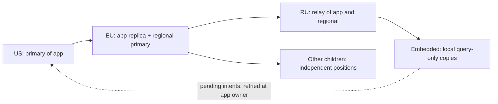

# Cascading replication spike

Research against TinyStore's `rust` at the commit in `source-revision`.
This is an independent crate; the product imports none of it. The research
branch and the product checkout's branch are `experiment/cascading-replication`.
The product Rust code and the research submodule pointer are unchanged.

```sh
cd <repo>/tinystore/replication-spike
sh bootstrap.sh
cargo test --locked
cargo clippy --all-targets --locked -- -D warnings
./target/release/tinystore-replication-spike demo
./target/release/tinystore-replication-spike probe
./target/release/tinystore-replication-spike bench
./target/release/tinystore-replication-spike batch
```

`bootstrap.sh` makes an isolated source worktree if missing, checks its commit
and clean state, and builds once. `demo <fresh-directory>` keeps all node
directories for inspection. Without a directory it uses a temporary one.
For measurements put `TMPDIR` on the storage under test, outside the source
tree; record its filesystem with `python3 environment.py`.

## Shape



A node owns some streams and follows others. A stream is one SQLite file,
one owner, one epoch and a sequence of captured states. Receiving a packet
preserves its stream and bytes in the relay's journal, so it can serve the
same packet to its children. A relay's own database is another stream and
appears in its catalog, including databases added later.

There is no ordering or atomicity between streams. A database's SQL, KV and
jobs tables share its file and replicate in the same page transaction.
Imported files sit under `replicas/<stream>.db`, so their names cannot collide
with a relay's `sql/<name>.db`. The demo uses `us-app` and `eu-local`; the
product needs stable file UUIDs and an explicit namespace/catalog policy.

## What is implemented

- Consistent snapshots through SQLite's pager, page diffs and zstd level 3.
- A durable SQLite journal with immutable packets and a materialized image.
- SHA-256 of every page, excluding only SQLite's two local change counters.
- Strict order and predecessor checks, idempotent delivery, epoch markers.
- Stage-before-apply and restart replay across both crash windows.
- Query-only imported files, complete SQLite transactions for page apply.
- Pull batches bounded by entries and bytes; a current snapshot if history
  was pruned. A snapshot that exceeds the requested limit returns an error.
- Manual, explicitly fenced promotion of a stream; downstream old epochs
  are refused. Promotion verifies the current copy before opening writes.
- A loopback TCP driver and catalog discovery. It has no production wire
  integration, TLS or authentication, and binds only 127.0.0.1.
- A separate SDK outbox experiment: pending trusted SQL intents survive
  reopen; the primary commits the request ID with the effect in one database
  transaction. Retrying a lost response does not repeat that effect.

`demo` starts US, EU and RU endpoints and an embedded consumer, bootstraps
140 child directories through TCP, prunes history and bootstraps a late
child, checks local reads with the upstream endpoint unavailable, resumes
retained data, then closes the old primary and promotes EU's inherited
stream. Its outbox demonstration injects unavailability and a lost response
through a delivery callback; physical replication itself uses actual TCP.

## Durability and the two queues

The replication journal stores changes already accepted by the primary.
Consumers ask again from their last applied position after an outage. No
per-child copy of that backlog is needed. Once history is pruned, a slow
consumer takes a new snapshot.

The outbox stores application intentions not yet acknowledged by a primary.
An enqueue is **pending**, not a successful database write. Pending data is
not overlaid on the copied database and does not appear in local queries.
The demo's intent targets its trusted application database; the outbox is
not part of the page protocol. It drains at most 32 intents per call. Disk
and receipt-retention limits remain work for an SDK implementation.

Async replication can lose accepted but unshipped changes on failover. A
test deliberately leaves two checkpoints behind and observes both absent
after promotion. Sync acknowledgement is not implemented: it requires a
commit receipt held durably by the selected standby before returning to the
writer. An epoch checked by consumers cannot itself stop two disconnected
primaries accepting writes; promotion requires external fencing or a lease.

## Research limits

The capture scans the entire source and the journal's previous image.
Sequences count captures, not commits; multiple commits between captures are
coalesced, so this is not point-in-time recovery. There is no WAL hook,
checkpoint coordination, automatic failover, sync write acknowledgement,
automatic retention budget, object shipping for blobs or primary routing in
the SDK. Snapshots and logical files are limited to 16 MiB. They travel as
one bounded packet, not a chunked snapshot. The receiver journal duplicates
the current image; production should not copy that storage design blindly.

SHA-256 checks a canonical page image, not raw file equality. See the
[first report](../reports/scaling-pages-2026-10-15.md). The applier opens a
dedicated writer per apply, uses a single statement to install pages and
truncation, closes it, then verifies through a fresh read transaction.
Persistent engine handles are not opened on inherited files. The manual
promotion demo writes SQL to the promoted file; it does not restart all
TinyStore engines or their background work there.

The benchmark compares paired configurations in one process, three
interleaved passes each. Its star and tree use the same data, 140 child
directories and seven concurrent clients. It measures loopback on one
managed Linux container, not intercontinental links or 140 physical servers.
No build or test runs during its timed interval. Measurements preceded the
harness commit; those working-tree states are identified by hashes and
archived source snapshots. The results remain provisional pending independent
reproduction of the committed research.
