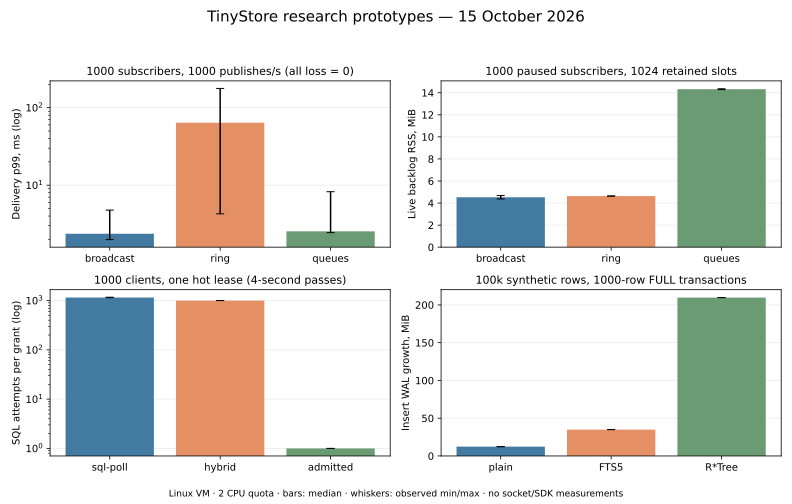

# Channels and Locks implementation handoff — 15 October 2026

This round is an implementation reference for the owner and the agent that
will write the product code. It does not change TinyStore's API or implement
phase 5. Prototype source, raw processes and limitations accompany every
number. The reviewed product commit is
`76b844cdc8c3410e746a5d5dc3e9aafec83c9962` on rust; the work branch is
`research/channels-locks-2026-10-15`.

| Direction | Recommended starting implementation                                                                                                                 | Evidence and remaining boundary                                                                                                                                       |
| --------- | --------------------------------------------------------------------------------------------------------------------------------------------------- | --------------------------------------------------------------------------------------------------------------------------------------------------------------------- |
| Channels  | Runtime-neutral shared byte/count-bounded log, per-subscriber cursor, sticky gaps, literal exact/subtree selector trie, credit-aware session drain. | [Fan-out, loss and memory](channels-2026-10-15.md). A custom lock-free ring is not justified; socket/SDK throughput remains unmeasured.                               |
| Locks     | File-local persisted conditional lease/permit primitive, retained fencing identity, bounded targeted FIFO admission and expiry scheduling.          | [Contention, durability and crash checks](locks-2026-10-15.md). Admission saves attempts/CPU but can cost commit grouping; production waiter lifecycle is not built.  |
| Indexes   | FTS5 and R*Tree, with transactional trigger maintenance and generation/frontier state for a chunked build.                                          | [Index cost and rebuild](indexes-2026-10-15.md). The measured monolithic build preserves old reads but excludes writers; chunked correctness remains a separate gate. |

## What to build first

1. Set the behavioral contracts: registration readiness, exact/subtree paths,
   loss/reset semantics, order within a file, grant expiry, cancellation and
   ambiguous responses. Make these explicit in the API book before SDK code.
2. Build the ownership primitive in the same SharedFile as its caller, then
   use it for default public Locks in kv.db and Jobs' internal permits in
   their own home. Preserve job attempt accounting independently.
3. Build the bounded channel log and router in the core without forcing a
   runtime on direct Rust callers. Implement channel stream credit and a
   connection-wide byte budget before exercising network fan-out.
4. Integrate transaction staging/savepoints and an ordered after-COMMIT
   handoff. The writer may append bounded metadata; subscribers and user
   callbacks run outside it. Reserve memory before durable changes.
5. Add SDK iteration/close/reconnect and lease helper cancellation/renewal.
   Measure embedded, sidecar and TCP with real serialization and receivers.
6. Build chunked index generations only after foreground writer p99, WAL
   reservations and failure behavior are measurable together.

## The architectural traps to carry into implementation review

| Source at the reviewed commit                                                                                                                                                                                                                                                       | Trap                                                                                                                                                                                                                  | Required response                                                                                                                                |
| ----------------------------------------------------------------------------------------------------------------------------------------------------------------------------------------------------------------------------------------------------------------------------------- | --------------------------------------------------------------------------------------------------------------------------------------------------------------------------------------------------------------------- | ------------------------------------------------------------------------------------------------------------------------------------------------ |
| [transaction.rs](https://github.com/tinyshed/tinystore/blob/76b844cdc8c3410e746a5d5dc3e9aafec83c9962/crates/tinystore/src/transaction.rs)                                                                                                                                           | `Ended` stores a transaction-wide callback list; a failed call/savepoint does not automatically truncate a future channel event staging list. Returning from COMMIT can also be overtaken by another thread's return. | Scope staging to savepoint marks and decide whether commit order is promised; use a writer-ordered handoff for that promise.                     |
| [sqlite/group.rs](https://github.com/tinyshed/tinystore/blob/76b844cdc8c3410e746a5d5dc3e9aafec83c9962/crates/tinystore/src/sqlite/group.rs)                                                                                                                                         | Grouped calls share a COMMIT and failures are savepoint-scoped; some COMMIT errors are OutcomeUnknown.                                                                                                                | Release successful staged batches only after the whole group succeeds; discard failed savepoints; define refresh/reset after an unknown outcome. |
| [wire/session.rs](https://github.com/tinyshed/tinystore/blob/76b844cdc8c3410e746a5d5dc3e9aafec83c9962/crates/tinystore/src/wire/session.rs)                                                                                                                                         | `Output.bytes` grows as frames are encoded; `KEPT` is an after-drain capacity policy, not a bound.                                                                                                                    | Spend stream/connection byte credit before enqueue, bound aggregate pending output, and keep gap metadata outside droppable data.                |
| [wire/config.rs](https://github.com/tinyshed/tinystore/blob/76b844cdc8c3410e746a5d5dc3e9aafec83c9962/crates/tinystore/src/wire/config.rs) and [wire/jobs.rs](https://github.com/tinyshed/tinystore/blob/76b844cdc8c3410e746a5d5dc3e9aafec83c9962/crates/tinystore/src/wire/jobs.rs) | Existing follows show credit gating and “response before data”; latest-state coalescing there is not generic event delivery.                                                                                          | Reuse the stream lifecycle, but preserve explicit event loss instead of silently adopting latest-value semantics.                                |
| [jobs/claim.rs](https://github.com/tinyshed/tinystore/blob/76b844cdc8c3410e746a5d5dc3e9aafec83c9962/crates/tinystore/src/jobs/claim.rs)                                                                                                                                             | Job renewal checks attempt identity, not current TTL; its token lifetime belongs to the job attempt.                                                                                                                  | Public renewal must also require a live expiry and retain a fencing identity beyond lease deletion/recreation.                                   |
| [jobs/engine.rs](https://github.com/tinyshed/tinystore/blob/76b844cdc8c3410e746a5d5dc3e9aafec83c9962/crates/tinystore/src/jobs/engine.rs) and [jobs/rows.rs](https://github.com/tinyshed/tinystore/blob/76b844cdc8c3410e746a5d5dc3e9aafec83c9962/crates/tinystore/src/jobs/rows.rs) | Opening the engine counts dead job attempts and deletes lease rows; jobs can live in an application SQL file.                                                                                                         | Keep lifecycle policy separate, and do not move group permits into another file without an atomicity design.                                     |
| [plan/architecture.md](https://github.com/tinyshed/tinystore/blob/76b844cdc8c3410e746a5d5dc3e9aafec83c9962/plan/architecture.md)                                                                                                                                                    | “Build beside old in the background” does not bound the single writer's exclusion interval or WAL retention.                                                                                                          | Use explicit chunk/frontier generations and mixed-workload/failure gates before promising online rebuild.                                        |

These findings identify reuse boundaries; they do not claim those modules
already violate their existing promises. Jobs' process-owned lease policy and
Config's latest-state follow have different contracts from new public Locks
and Channels.

## Evidence inventory and limits

Bars are medians, whiskers are observed min/max over three main or two
resource passes. [PNG export](data/channels-locks-2026-10-15/comparison.png).
The chart is a view of the same raw data, not an additional measurement.

The core harness source tree was committed before calibration and all main
runs; its public envelope is `65dfba8c9e2ccc34580e415cc24ddfeabd2d25a4`.
Longer controls add only a dispatcher (public envelope `82e70b8`);
the compiled Rust paths are unchanged. The shared Go source
submodule is intentionally not moved: this round does not import it and
does not claim to measure the Rust product itself.

Isolated waiter RSS adds only a new probe whose tree was committed before
those twelve fresh-process cases (public envelope `e6e298b`). Existing timing behavior is unchanged;
the source also corrects a payload-allocation comment, not an allocator path.

The first push was rejected by GitHub GH007 because the configured Git email
was private. Before publication, new noreply commit envelopes were made over
the **identical Git trees**, with current committer dates. Original commits
remain unchanged in local private refs. The
[original/public ID and tree-hash map](data/channels-locks-2026-10-15/commit-identity-map.json)
records this exception explicitly. Raw environment.json intentionally keeps
its original pre-run commit ID and every measured JSONL remains byte-identical.
The cited product base `76b844c` and all previously public history are unchanged.

| Suite          | Cases | Start UTC                        | End UTC                          |
| -------------- | ----- | -------------------------------- | -------------------------------- |
| preflight      | 13    | 2026-10-15T18:06:09.587183+00:00 | 2026-10-15T18:06:21.234813+00:00 |
| kill           | 6     | 2026-10-15T18:06:50.004069+00:00 | 2026-10-15T18:06:52.178513+00:00 |
| channels       | 81    | 2026-10-15T18:06:52.324894+00:00 | 2026-10-15T18:09:17.634717+00:00 |
| resources      | 48    | 2026-10-15T18:09:17.798959+00:00 | 2026-10-15T18:09:35.286604+00:00 |
| leases         | 72    | 2026-10-15T18:09:35.436479+00:00 | 2026-10-15T18:15:02.340439+00:00 |
| lease-controls | 28    | 2026-10-15T18:15:02.489338+00:00 | 2026-10-15T18:17:01.542139+00:00 |
| indexes        | 9     | 2026-10-15T18:17:01.740337+00:00 | 2026-10-15T18:18:03.460458+00:00 |
| soak           | 10    | 2026-10-15T18:18:36.429075+00:00 | 2026-10-15T18:23:39.052326+00:00 |
| waiter-memory  | 12    | 2026-10-15T18:24:16.132155+00:00 | 2026-10-15T18:24:18.899952+00:00 |

All processes are sequential. Three rotating main passes and two alternating
controls establish observed variability, not statistical confidence intervals.
The longest controls are 30 seconds, not a multi-hour stability test. The
machine is a Linux VM/container with an unknown storage controller and a
two-CPU quota. [Environment](data/channels-locks-2026-10-15/environment.json),
[audited tables](data/channels-locks-2026-10-15/tables.md),
[table generator](data/channels-locks-2026-10-15/summarize.py),
[prototype and reproduction](../channels-locks-bench/README.md).

The benchmark's lease latency sample vectors grow with attempts; its process
HWM must not be sold as the engine's fixed RAM budget. Channels backlog RSS
is measured separately with all consumers parked. Saturated Channels latency
is conditional on receipt and meaningless alone when most events are lost.
R*Tree's rectangle query and plain LIKE are different predicates. Rebuild
write exclusion is measured as transaction duration, not as concurrent writer
p99. SIGKILL under injected times does not simulate power loss or establish
clock-jump behavior. No Windows/macOS, socket/TLS, real SDK workload,
multi-publisher order proof, distributed lease, HA election, vector search,
chunked rebuild or replicated WAL traffic is tested here.

## Implementation gates

Final research checks pass: rustfmt, warning-free release clippy, overflow/
TTL/COMMIT semantic probes, evidence-count/timeline/loss audit, raw hashes
and report-link/table verification. [Research check log](data/channels-locks-2026-10-15/checks.txt).

The documentation-only product branch is public commit
`844caee623f572801e0e0135a50609dc839bb03c`, with the exact tree checked before
the metadata correction above. Its `just check` passes formatting,
all feature lints, 903 Rust tests (5 ignored), generated protocol checks,
991 Bun SDK tests (1 skipped, 0 failed), SDK lint and typecheck. The recipe
then exits 3 because the actionlint image's default user cannot read this
checkout's 0700 directories. Running the same actionlint image/workflow
files with `--user 0:0` passes, without changing repository permissions or
source. [Complete sanitized log](data/channels-locks-2026-10-15/product-check.txt).
These are Linux correctness checks, not new performance measurements or
evidence that the proposed Channels/Locks API already exists.

The following remain gates for the future product implementation:

- Channels: exact loss intervals including a lost final tail; no callback
  before successful COMMIT; failed call/group/outer transaction suppressed;
  bounded staging on rollback/panic; registration-response ordering;
  disconnect/cancel cleanup; zero credit and many streams on one connection;
  immutable payload sharing; reset and versioned snapshot recovery; a
  Channels-only feature build without Jobs enabling its transaction hook.
- Locks: owner/fence match; no renewal at/after expiry; persisted token after
  reopen; stable semaphore slot identity; bounded/cancellable FIFO waiters;
  owner death and timed expiry wake; clock changes; delayed COMMIT/grant;
  lost response reconciliation; restore epoch and exact SDK token integers;
  Jobs claim/group atomicity in every file home.
- Indexes: mixed writes and reads across the build frontier; updates/deletes
  and rowid moves across both frontier and high watermark; crash/resume and
  schema change during build; equivalence to a clean rebuild; bounded
  writer occupancy, WAL/disk reservations and safe generation switch/drop.

Every acceptance number should be set from a real application/SDK workload,
not copied from these synthetic screening rates. There is no reason in this
evidence to expand scope to distributed Channels/Locks or vector search.
