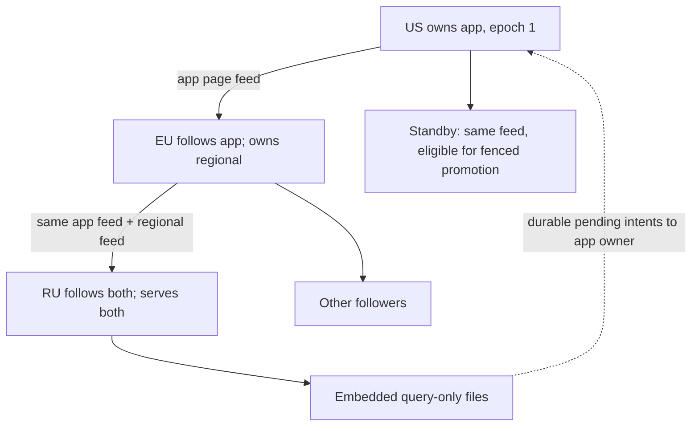

# Scaling: implementation handoff — 2026-10-15

The smallest useful design is one owner and one durable page stream per
SQLite file, pulled by followers. A relay keeps and serves the same stream;
its own local databases are additional streams. The embedded copy is the
same follower with its transport in the SDK. An offline-write queue belongs
beside that copy and contains pending intentions, not edits to replicated
pages.

This is a proposal for the Rust implementation, grounded in
[page application](scaling-pages-2026-10-15.md) and
[cascade measurements](scaling-cascade-2026-10-15.md). The running
[spike](../replication-spike/README.md) is research, not product code. No
production API or scaling-plan decision is silently changed by these notes.

## One mechanism, several uses



```text
capture(file commit)      -> append once to the file's durable log
pull(file, cursor, bounds)-> immutable entries, or a snapshot if too old
apply(entries)           -> verify, persist, apply whole states, advance cursor
serve(file, cursor)      -> the same log entries, including received entries
```

The daily distinction is per file: **owned** or **followed**. A standby,
read replica and embedded replica differ in routing and promotion policy,
not in storage format. A physical machine may own a regional database and
follow foreign databases simultaneously. No operation becomes atomic across
two files merely because they happen to share a machine.

Use a stable file UUID plus a human name, an authority epoch, a monotonic
sequence and a checksum. Preserve identity and order through relays. Do
not give a received entry a new local sequence. Independent owned files use
different IDs even when both are called `app.db`.

The prototype discovers the parent's catalog on each `follow` pass; a newly
published regional database then appears below it. The production catalog
needs capability checks and subscription filters. A child must not silently
import every database merely because it can connect to a multi-tenant relay.

## Separate local ownership from replication policy

An owned file opens through the existing TinyStore engine and its writer.
An imported file opens only through the page applier and query-only readers.
Do not run its expiry, jobs, migrations, packing, merges, counters or config
writers. The relay's owned databases still run their ordinary work.

Consequently, disabling all background work on the whole store is not a
complete relay implementation. It would disable the relay's own jobs too.
Authority and background scheduling must follow the file, and a route to an
imported file must not accidentally open the engine's normal writer.

The prototype proves SQL queries on imported files and a shared SQL/KV/jobs
file's page consistency. It does not supply normal KV/jobs/records/metrics
reader handles on replicas or restart those engines after promotion. Those
are implementation work, not behaviour to advertise from the demo.

## Acknowledgement defines what survives

| Event                                    | What is durable                                                     | What may be answered                                        |
| ---------------------------------------- | ------------------------------------------------------------------- | ----------------------------------------------------------- |
| Local intent enqueued while offline      | The intent on that client's disk                                    | Pending; it is not a database commit.                       |
| Primary commits, async mode              | Its local database and recoverable replication log                  | Accepted locally; an unshipped suffix can be lost.          |
| Selected standby persists the entry      | A recoverable copy in another configured failure domain             | Sync acknowledgement, after a valid durable receipt.        |
| Embedded follower applies the receipt    | Its local readable copy includes the acknowledged commit            | Read-your-write completion for that copy.                   |
| Primary permanently disappears           | Whatever its surviving followers actually held                      | Nothing promises an unshipped async suffix.                 |

The async-loss test leaves exactly two captured updates unshipped and sees
both absent after promotion. An epoch by itself cannot prevent this loss.
Zero RPO for acknowledged writes requires waiting for a suitable standby;
if it cannot be reached, that write remains unacknowledged. A separate
explicit policy could allow an async fallback, but it changes the promise.

A standby's durable journal can acknowledge before applying pages if its
startup always replays that journal before promotion. A receipt must identify
the file and lineage, not just a larger integer. Choose which failure domain
must hold the copy: an acknowledgement from a nearby relay does not imply
that a downstream region has received it too.

## Offline writes are a second queue

Keep the page copy read-only. Store `(client, request ID, target stream,
intent)` in a separate durable SDK outbox. On reconnect, send intents to the
current owner; commit the effect and its deduplication receipt together in
that database. A response lost after commit then becomes a safe retry.

The spike demonstrates exactly that failure through a delivery callback.
It does not yet implement write forwarding over the page transport. Pending
intents are not visible in local searches. If optimistic offline visibility
is required, it needs a separate overlay with application conflict rules;
that would enlarge the product's current single-writer promise.

Deduplication also needs limits. Receipt retention must outlive the permitted
retry window, or an expired client request must be refused rather than
executed twice. An async failover can lose an unshipped receipt together
with its effect; the durability mode applies to this guarantee too.

## A tree unloads the root without a per-child backlog

Use one retained log per file. Each child keeps its own durable position and
asks for a bounded prefix. Do not append one queue entry for each of 140
children in the primary's write path. A slow child should fall out of
retention and restart from a snapshot rather than pin the log forever.

The measured 7 × 20 arrangement sends 7 copies from the root instead of 140:
101,150 versus 2,023,000 response bytes on the fixture. It creates 7 extra
replicas and 5% more total response traffic. This is a bandwidth distribution
mechanism, not free replication or a consensus group of 140 members.

Start transport experiments from the tested 32-entry / 256-KiB caps. They
are provisional defaults, not an optimum. The 100-state backlog needs 4
requests instead of 100. The applier still commits each state separately;
grouping durable journal appends and applying a verified prefix together
are the next optimisation candidates, with crash boundaries tested again.

Production also needs limits on concurrent sends, decoded bytes, zstd
windows, snapshot chunks, disk reserve, log age and log bytes. Reuse immutable
packets across children; a slow network write must not hold the file writer
or a shared node lock. The prototype releases its lock before writing TCP,
but its simple loopback server handles one connection at a time and has no
long-polling or production scheduler.

An interrupted child retries from its applied cursor. If a relay disappears,
it may reparent to an allowed ancestor carrying the same stream and lineage,
or bootstrap if that ancestor no longer has its history. Automatic parent
selection, endpoint lists and admission are not implemented in this spike.

## Promotion needs fencing outside the page stream

Two disconnected machines cannot distinguish an unavailable peer from a
partition. A manually promoted standby requires the old writer to be
stopped or otherwise fenced. Automatic promotion needs a lease/witness and
a write gate that expires before another owner can take over.

Raise the authority epoch, reject old-epoch packets and route writers to
the new owner. Make a returning old primary follow the new lineage before
opening any engine writers. Do not merge its divergent tail. Keep other
databases that it legitimately owns; recovery of one imported stream must
not require deleting the node's whole directory.

The prototype checks promotion integrity and emits a durable epoch marker;
its consumers refuse stale changes. It does not fence the old process by
itself. It has no automatic demotion, per-stream rebuild API, lease or
automatic failover. A detected unexpected post-apply integrity failure is
fail-stop; automatic repair is another missing recovery path.

## Where to attach this in the current Rust core

The reference below is TinyStore `76b844c`, not a changed product tree.

| Seam                                             | Required work                                                                                                                   |
| ------------------------------------------------ | ------------------------------------------------------------------------------------------------------------------------------- |
| `sqlite/group.rs`, commit in `Group::lead`       | Capture after COMMIT succeeds while the writer is held, before releasing it and answering the grouped writes.                   |
| `sqlite/file.rs`, `File::commit`                 | Cover exclusive transactions and `Begun::commit`; migrations travel through these paths too.                                    |
| `sqlite/connection.rs`, writer configuration     | Coordinate checkpoints and disable automatic WAL reset before the committed frames have been retained.                          |
| `sqlite/file.rs`, startup and close              | Recover uncaptured durable WAL frames before accepting writes; never truncate required WAL on close.                            |
| `engine::Host` and file ownership                | Give followed files readers and an applier without opening normal writers or scheduling their background tasks.                 |
| Backup and engine snapshots                      | Add physical snapshots at a known position; `VACUUM INTO` renumbers pages and cannot seed this delta stream.                    |
| Wire schema, CLI and SDKs                        | Transport, capabilities, roles, receipts, cursors, catch-up, write routing and optional outbox; no network runtime in the core. |
| Blobs engine                                     | Ship immutable object bytes before the metadata commit that names them; retain them while a snapshot/log needs them.            |

Never capture from `update_hook` or replay SQL. Neither covers arbitrary
engine maintenance and nondeterministic SQL correctly. A SQLite commit hook
runs before a commit is final. The adapter already owns every relevant
writer and completion: use those exact boundaries and keep network waits
outside the writer lock.

The source's commit and a log append are distinct durability events. Define
what happens if the database commit succeeds but the append fails: preserve
the WAL and return an outcome consistent with the real local commit, rather
than claiming a rollback. On recovery, identify WAL generations by salts
and commit frames. A checkpoint must not erase the only copy of a commit
that was already acknowledged under the chosen policy.

The present SHA-256 implementation reads whole images. Merely replacing page
diffing with WAL reads will not remove that whole-file integrity work.
Measure full checksums, periodic full verification and an incremental page
checksum tree against the same fixture before choosing the contract. The
research measured the entire capture pipeline, not these alternatives.

## Gates before calling this a product feature

1. The file/epoch/sequence and canonical-checksum contracts are accepted.
   SQLite's change counters must be treated explicitly; raw file equality
   is not the gate that this applier passed.
2. Every grouped, submitted and exclusive commit path captures correctly,
   including schema changes, truncation and crash recovery around checkpoints.
3. Followers see complete states while readers, DDL and maintenance run;
   imported files run none of their own background writes.
4. Reconnect, lost replies, reordered/duplicate packets, retained-log gaps,
   interrupted snapshots and corrupted unchanged pages have recovery tests.
5. Full-store snapshots include blobs' external objects and preserve the
   same per-file positions as subsequent entries.
6. Sync acknowledgement survives destroying the primary's directory;
   async failover reports the measured lost suffix honestly.
7. A network partition cannot leave two lease-controlled owners accepting
   writes; a returning old primary cannot resume its divergent tail.
8. Outbox retries, receipt expiry, primary routing and read-your-write
   waiting have SDK tests, with pending distinct from committed.
9. A long-running 140-client test has bounded memory and disk, fair slow
   consumers, retention pressure and actual WAN/failure-domain measurements.

The current 21 behaviour tests and small paired measurements establish the
mechanism's shape and its first traps. They do not close those production
gates. The immediate next implementation slice should be WAL capture,
checkpoint recovery and a physical follower reader, before automatic failover
or a broader distributed feature set.

## WAL follow-up — 15 October 2026

[The WAL capture/recovery round](scaling-wal-2026-10-15.md) supersedes the
full-snapshot capture as the candidate hot path and measures early forwarding
with a separate applier. The figures above remain measurements of the older
pipeline; do not combine their timings with the new same-session comparisons.
Native capture, recovery and durable receipt are now prototyped; release,
retention, real power-loss and fencing gates remain open.
