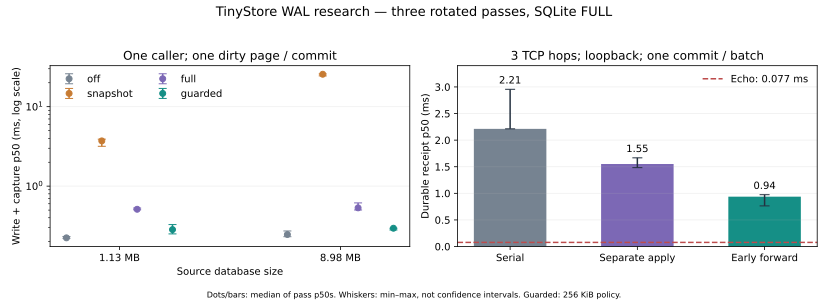
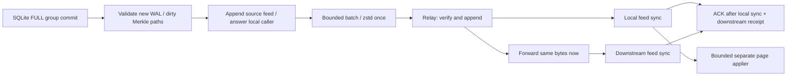

# WAL capture, crash recovery and propagation — 15 October 2026

Native WAL capture removes the database-size scan from every commit. It is
11–87 times faster than the preceding snapshot pipeline in guarded mode on
these same-session fixtures. It is still slower
than writes without replication. Forwarding verified, appended batches while
sync runs, with a separate page applier, cuts three-hop durable receipt from
2.21–2.96 ms to 0.76–0.97 ms on loopback. Pure loopback RTT is 0.08 ms: the
network-only target is not achieved there.

| Question | Answer from this round | What follows |
| --- | --- | --- |
| Can capture follow real engine commits? | Native WAL hook + checksummed frame parsing runs before the grouped/exclusive transaction answers; no explicit scanner call is needed. | Keep capture at the SQLite writer seam, once per group. |
| Does recovery preserve acknowledged commits? | All 33 abrupt-worker scenarios passed, including eight SIGKILL prefix checks, five unsynced-tail loss/corruption models, two checkpoint policies and receiver death before apply. | This is process-death and injected-file-loss evidence, not power-cut certification. |
| What is the write overhead? | Single-caller guarded p50 0.250–0.329 ms versus 0.221–0.273 ms without capture. Initial 64-caller tests retain 55–77%; the 4 MiB checkpoint control retains 64–85% of its own uncaptured throughput. | The full scan is gone; the remaining overhead is material and needs a production budget. |
| Can a cascade approach the network floor? | With injected 5 ms in each direction per hop, three-hop echo is 30.85–30.99 ms; optimized durable receipt is 31.48–31.73 ms, 2.0–2.5% above echo. | Plausible WAN target, explicitly a delay-injected local model. Local write/capture adds more time. |
| What helps propagation? | Separate applier, early forwarding, immutable compressed batches, batching. | Keep durability ACK and searchable visibility separate. |
| Can primary disk loss preserve ACKs? | The independent standby is rebuilt and queried after the primary directory is deleted, after standby feed sync. | Only a client ACK gated on independent durable receipt can make this promise. Product remote-ACK policy and fencing are still absent. |

This extends [the interim architecture](scaling-wal-design-2026-10-15.md) and
supersedes its durable-before-forward schedule as the recommended fast path.
The earlier [cascade](scaling-cascade-2026-10-15.md) and
[handoff](scaling-handoff-2026-10-15.md) remain the topology/outbox experiments;
this round replaces their full-snapshot capture as the candidate hot path.
It does not turn either prototype into a product replication API.

The [sustained mixed-load follow-up](scaling-wal-load-2026-10-15.md) supersedes
this round's short-load checkpoint/hot-path recommendation. It keeps these
numbers intact, measures a bounded-cache/owned-encoding candidate, separates
component costs and adds reader-pressure admission and a longer soak.

## Environment and reproduction

- TinyStore: `690cdf3d45e99e8f19ca3bf651461f35cfe45673`, branch
  `experiment/wal-capture`, based on Rust `76b844c`; not merged into the product.
- Initial committed harness: `fef36bba9ccc964ffb707109789281fdde8e22a5`.
  Its `capture.jsonl` and `network.jsonl` are preserved. The 256-operation
  concurrent capture runs are exploratory; use the longer follow-up below.
- Follow-up harness: `9f9d0d984e457e540cda7f0ceff8718583b62671`:
  `grouped.jsonl` and `pipeline.jsonl`, committed before either measurement.
  Fault-model expansion: `036ba8a` (no measured-path changes). Threshold-only
  follow-up and final tests: `5c88ca9a8268999a1fd5fc351617d6e85e5fce55`,
  `checkpoint.jsonl`, committed before measurement.
- Frozen snapshot baseline copied from research `4d95f68`; only module paths
  and visibility changed. It runs against the same product/SQLite as the new
  capture. Its explicit scanner serializes write+capture; latency includes
  waiting for that serialization and cannot benefit from SQLite grouping.
- Linux managed container, kernel 6.18.44, AMD EPYC 9V74, 3 visible CPUs,
  cgroup quota 2 CPUs, memory limit 8 GiB. Rust/cargo 1.99.0, Bun 1.4.2, SQLite 3.53.2.
  Exact SQLite version and flags are in the raw configuration/environment.
- Files under a disk-backed scratch directory on overlayfs; physical backing
  device/controller/cache guarantees are unknown. No build, test or lint ran
  during the timed programs.
- Release build, bundled SQLite with dbpage for read/apply verification,
  DQS=0, memory-management cache disabled, HAVE_FDATASYNC=1. Every mode uses
  the same binary and SQLite FULL. No SQLite durability weakening is credited.
- Synthetic deterministic SHA-256 hex strings, 256 bytes each; 4096 or 32768
  rows. Source preparation and value generation are outside measurement.
  This is not a production corpus or a sustained multi-machine load test.

```sh
# In a research checkout at the named harness revision:
cd <repo>/tinystore/wal-spike
./bootstrap.sh
cargo test --locked
cargo clippy --all-targets --locked -- -D warnings
cargo build --release --locked
TMPDIR=<disk-backed-scratch> python3 environment.py
TMPDIR=<disk-backed-scratch> target/release/tinystore-wal-spike bench
TMPDIR=<disk-backed-scratch> target/release/tinystore-wal-spike network
# At the follow-up revision:
TMPDIR=<disk-backed-scratch> target/release/tinystore-wal-spike grouped
TMPDIR=<disk-backed-scratch> target/release/tinystore-wal-spike pipeline
# At the threshold-only follow-up revision:
TMPDIR=<disk-backed-scratch> target/release/tinystore-wal-spike checkpoint
```

The old Go submodule stays pinned where it was. This Rust module has its own
ignored worktree and exact `source-revision`. All passes rotate candidate
order. Cells below list passes 1; 2; 3, not confidence intervals. The raw JSONL
contains p95/p99, totals, byte accounting and verification results.



Plot: median of the three per-pass p50 values; whiskers are their min/max,
not a confidence interval. Initial capture and pipeline follow-up data; the
guarded series here uses the original 256 KiB policy.

| Program | Start UTC | End UTC | Timed cases |
| --- | --- | --- | --- |
| capture | 2026-10-15T13:25:31Z | 2026-10-15T13:26:30Z | 48 |
| network | 2026-10-15T13:26:48Z | 2026-10-15T13:28:41Z | 48 |
| grouped | 2026-10-15T13:32:19Z | 2026-10-15T13:32:25Z | 18 |
| pipeline | 2026-10-15T13:32:45Z | 2026-10-15T13:34:06Z | 27 |
| checkpoint | 2026-10-15T13:48:22Z | 2026-10-15T13:48:28Z | 18 |

Raw data: [environment](data/scaling-wal-2026-10-15/environment.json),
[follow-up environment](data/scaling-wal-2026-10-15/environment-followup.json),
[capture](data/scaling-wal-2026-10-15/capture.jsonl),
[grouped](data/scaling-wal-2026-10-15/grouped.jsonl),
[network](data/scaling-wal-2026-10-15/network.jsonl),
[pipeline](data/scaling-wal-2026-10-15/pipeline.jsonl),
[derived paired ratios](data/scaling-wal-2026-10-15/derived.json),
[checkpoint control](data/scaling-wal-2026-10-15/checkpoint.jsonl),
[checkpoint ratios](data/scaling-wal-2026-10-15/derived-checkpoint.json).

## Capture scales with dirty pages

256 updates per case, one caller. Every update in these cases dirties one
SQLite page; source file size remains constant. `full` means source FULL plus
feed sync per commit; `guarded` means source FULL plus retained native WAL,
feed sync before coordinated checkpoint. `off` uses no observer.

| Source bytes | Mode | p50 write + capture, ms | p95, ms |
| --- | --- | --- | --- |
| 1,130,496 | off | 0.224; 0.221; 0.232 | 0.430; 0.449; 0.444 |
| 1,130,496 | snapshot | 3.710; 3.904; 3.170 | 5.727; 8.638; 3.654 |
| 1,130,496 | full | 0.505; 0.531; 0.512 | 0.846; 1.588; 0.951 |
| 1,130,496 | guarded | 0.329; 0.284; 0.250 | 0.656; 0.617; 0.565 |
| 8,978,432 | off | 0.231; 0.246; 0.273 | 0.404; 0.565; 0.452 |
| 8,978,432 | snapshot | 25.585; 25.846; 24.373 | 33.536; 36.254; 28.891 |
| 8,978,432 | full | 0.615; 0.533; 0.502 | 0.915; 1.089; 0.853 |
| 8,978,432 | guarded | 0.295; 0.296; 0.281 | 0.780; 0.599; 0.568 |

On paired p50s, guarded capture is 11.29–13.75x faster than snapshot capture
for the 1.13 MB file, and 86.59–87.44x for the 8.98 MB file. Against uncaptured
writes it adds 7.7–105.0 µs to single-caller p50 (3–47%). Host sync variation
is visible across passes; these ranges do not define a universal overhead.
The fixed dirty-page fixture supports the removal of O(database size) capture;
it does not establish performance on arbitrarily large databases or hot pages.

The SHA-256 Merkle tree updates changed leaves and their ancestors. Its
occasional capacity growth and source recovery still scan state. Each commit
retains a predecessor/root and final page count; WAL frames with no commit
marker never become feed entries. Page 1 canonicalization excludes only its
two pager-local change counters (8 bytes), as the earlier round established.

## Longer grouped-write control

4096 updates, 64 callers, same file fixtures. These replace the 8–12 ms,
256-operation concurrent runs as the useful throughput evidence. Even these
longer runs are only about 0.07–0.14 seconds, including caller startup: rates
are comparison observations, not a sustained QPS ceiling or saturation claim.

| Source bytes | Mode | Updates/s | p50 caller latency, ms | Captured SQLite commits |
| --- | --- | --- | --- | --- |
| 1,130,496 | off | 50087; 45912; 58866 | 1.058; 1.089; 0.920 | 0; 0; 0 |
| 1,130,496 | full | 33425; 34140; 43260 | 1.613; 1.606; 1.355 | 71; 73; 70 |
| 1,130,496 | guarded | 35874; 32565; 42145 | 1.455; 1.540; 1.210 | 73; 76; 72 |
| 8,978,432 | off | 52531; 46636; 53483 | 0.981; 1.146; 0.935 | 0; 0; 0 |
| 8,978,432 | full | 32861; 30967; 41016 | 1.648; 1.691; 1.361 | 71; 72; 69 |
| 8,978,432 | guarded | 35440; 35976; 29193 | 1.494; 1.556; 1.542 | 72; 73; 74 |

The observer captures 69–76 group commits rather than 4096 independent feed
syncs. Captured modes retain 54.6–77.1% of their same-pass uncaptured rates.
`guarded` is not uniformly faster than `full` here. Its 256 KiB feed flush /
checkpoint trigger is a candidate explanation, not an isolated result: the
remaining work includes dirty-page hashing, WAL checksum validation, copies,
feed append/sync and checkpoint frequency. The next section tests this hypothesis with a matched threshold-only control.

## Isolate the checkpoint policy

The longer grouped study exposed a candidate cost: 256 KiB is a frequent
checkpoint for grouped dirty pages. A third committed harness (`5c88ca9`)
changes only the dirty-feed threshold to 4 MiB. Both modes retain SQLite FULL,
the same independent 1024-native-WAL-frame trigger and feed-sync-before-checkpoint
ordering. Three rotated passes, 4096 updates / 64 callers, fresh identical
fixtures. This is a separate same-session matched comparison, not a ratio
against the earlier controls.

| Source bytes | Threshold | Updates/s | p50 caller latency, ms | p95, ms |
| --- | --- | --- | --- | --- |
| 1,130,496 | no capture | 52670; 49740; 46565 | 1.051; 1.014; 1.136 | 1.959; 2.072; 2.122 |
| 1,130,496 | 256 KiB | 33535; 33529; 36409 | 1.488; 1.507; 1.322 | 3.207; 3.377; 3.446 |
| 1,130,496 | 4 MiB | 40368; 31880; 39557 | 1.258; 1.256; 1.304 | 2.959; 2.853; 2.533 |
| 8,978,432 | no capture | 41934; 40037; 53448 | 0.976; 1.042; 0.986 | 2.332; 2.670; 1.852 |
| 8,978,432 | 256 KiB | 29232; 32307; 26747 | 1.714; 1.492; 1.658 | 4.245; 3.484; 6.230 |
| 8,978,432 | 4 MiB | 33669; 33202; 41217 | 1.521; 1.459; 1.312 | 2.956; 3.432; 2.266 |

The 4 MiB threshold lowers p50 and p95 in all six paired cases. Throughput
improves in five of six (2.8–54.1% there); the remaining pass loses 4.9%.
It retains 64.1–85.0% of its own uncaptured controls. This supports checkpoint
policy as a material cost, not a universal throughput win or zero-overhead
capture. More native WAL remains resident/on disk between checkpoints; inspect
its lengths in the raw storage accounting. Long-reader pressure is still open.

The larger limit also passes generation/reopen verification across 1100 inserts
and six abrupt-worker boundary cases. The default constructor remains 256 KiB
for reproducibility; the experiment can select 4 MiB explicitly. Prefer a
native-frame/byte policy near the ordinary SQLite checkpoint scale as the next
candidate, then measure sustained mixed load before fixing a product default.

## Disk and payload accounting

No codec saving is attributed to the source database: its geometry is identical
across modes. dbstat divides the source file as follows in every pass:

| Rows | documents b-tree | sqlite_schema | Total SQLite file |
| --- | --- | --- | --- |
| 4096 | 1,126,400 B | 4,096 B | 1,130,496 B |
| 32768 | 8,974,336 B | 4,096 B | 8,978,432 B |

The 256 single-caller captures contain exactly 1,048,576 dirty page bytes and
1,081,856 raw feed bytes, for either database size. A source feed also carries
an initial full seed and 36 bytes of framing/hash per entry. File sizes below
are logical file lengths in pass 1 before clean close; allocated blocks and
physical I/O were not measured. Native WAL is shown separately from the feed.

| Source bytes | Mode | Feed / replication.db | Its SQLite WAL | Source WAL |
| --- | --- | --- | --- | --- |
| 1,130,496 | snapshot | 3,043,328 B | 4,152,992 B | 1,054,752 B |
| 1,130,496 | full | 2,222,842 B | 0 B | 1,054,752 B |
| 1,130,496 | guarded | 2,222,842 B | 0 B | 32,992 B |
| 8,978,432 | snapshot | 15,785,984 B | 15,161,632 B | 1,054,752 B |
| 8,978,432 | full | 10,078,442 B | 0 B | 1,054,752 B |
| 8,978,432 | guarded | 10,078,442 B | 0 B | 32,992 B |

In the network fixture, 128 updates carry 540,928 raw feed bytes, excluding
initial snapshot. Batch=1 uses approximately 307–308 KB per edge; batch=32
uses approximately 50.9 KB: about 6.05x less application traffic (83.5% less),
and 128 sends become 4. Four-byte lengths are counted; receipt ACKs, echo,
initial snapshot, TCP/IP/TLS overhead and retransmissions are not. No bandwidth
limit or packet-loss model was imposed. The same encoded bytes cross every
relay; the source compresses once per batch, outside its writer.

A 32-commit batch also waits for 32 sequential FULL writes in this harness.
Its time from the first write is not directly comparable to one commit's
latency. There is no production batch timer, automatic coalescing policy or
configured maximum wait here; do not infer that waiting for 32 is required.

## Propagation: isolate sync, forwarding and apply

The initial network study uses real persistent loopback TCP_NODELAY sockets,
1 / 3 hops, durable / applied ACKs and batches of 1 / 32. It exposed head-of-line
blocking when the network thread applied the previous batch after its ACK.
The follow-up compares three schedules in rotated order, always with durable
ACKs through all three hops:

- **serial**: local feed sync, forward, apply on the network thread after ACK.
- **separate apply**: local sync, forward, bounded independent page applier.
- **early forward**: validate + append, forward, local sync overlapping
  downstream work, bounded independent applier. ACK still waits for local
  sync and downstream durable ACK. This does not weaken durable receipt.

The applier queue has eight batch slots and merges up to eight pending batches
into one SQLite apply. It shares immutable feed entries, not duplicate page
buffers. Full queues apply backpressure. This stage is still an experiment,
without production memory admission or a crash-persistent applied watermark;
on reopen it rematerializes history and verifies the final image.

| Batch | Injected one-way delay/hop | Schedule | Echo p50, ms | Durable receipt p50, ms | Source write start → receipt p50, ms |
| --- | --- | --- | --- | --- | --- |
| 1 | 0 ms | serial | 0.078; 0.064; 0.056 | 2.212; 2.212; 2.956 | 2.749; 2.787; 3.771 |
| 1 | 0 ms | separate apply | 0.056; 0.077; 0.077 | 1.668; 1.483; 1.551 | 2.291; 2.012; 2.168 |
| 1 | 0 ms | early forward | 0.077; 0.077; 0.079 | 0.764; 0.974; 0.937 | 1.271; 1.572; 1.562 |
| 1 | 5 ms | serial | 30.792; 30.976; 30.888 | 33.319; 33.605; 33.429 | 34.147; 34.453; 34.132 |
| 1 | 5 ms | separate apply | 30.984; 30.923; 30.852 | 32.366; 32.466; 32.266 | 33.300; 33.209; 32.954 |
| 1 | 5 ms | early forward | 30.853; 30.965; 30.989 | 31.478; 31.735; 31.675 | 32.261; 32.780; 32.685 |
| 32 | 0 ms | serial | 0.062; 0.062; 0.078 | 3.346; 3.167; 3.136 | 15.448; 15.347; 15.307 |
| 32 | 0 ms | separate apply | 0.076; 0.069; 0.062 | 2.987; 3.106; 3.775 | 11.969; 15.135; 12.645 |
| 32 | 0 ms | early forward | 0.078; 0.063; 0.077 | 2.026; 2.773; 2.863 | 11.663; 16.464; 12.708 |

On batch=1 without delay, early forwarding is 2.27–3.16x faster than serial
durable receipt, paired per pass. It remains 9.9–12.6x the measured loopback
echo. On the injected-delay fixture, the excess above echo is 0.624; 0.770;
0.686 ms (2.03; 2.49; 2.21%). From source write start, including capture and
encoding, receipt is 32.26–32.78 ms. These are local application-level sleep
injections, not measurements between geographical regions.

Durable receipt is not searchable visibility. The original one-hop applied
ACK without delay is 1.86–2.41 ms versus 1.38–1.46 ms for durable ACK; at
three hops applied ACK is 2.83–3.86 ms. The optimized background-applier path
verifies every final copy only after drain; it does not measure the per-commit
visibility lag. SQL page application remains a performance risk of its own.

## Crash recovery evidence and limits

[The tests](../wal-spike/src/tests.rs) exercise 16 parent tests and launch
33 abrupt workers. Three ignored tests are controlled child entry points, not
omitted verification. The final test state is `5c88ca9`.

| Fault model | Cases | Checked result |
| --- | --- | --- |
| Exit after SQLite COMMIT, feed append, feed sync, caller answer, before close checkpoint | 9 | Reopen recovers source + feed canonical root and row. Unacknowledged committed suffixes may remain. |
| Exit immediately before / after coordinated checkpoint | 4 | Complete feed prefix survives WAL truncation and reopen. |
| Guarded unsynced tail: corrupted final checksum, three partial losses, entire unsynced suffix after the seed | 5 | Native durable WAL reconstructs missing complete commits, including CREATE TABLE. |
| SIGKILL after observing ACK 1 / 8 / 31 / 64, both modes | 8 | Every acknowledged ID is present, source/feed roots agree; an extra unacknowledged suffix is allowed. |
| Receiver exit after feed sync, before page application | 1 | Restart materializes the searchable SQLite file; exact duplicate delivery is idempotent. |
| 4 MiB limit: six source/append/ACK/checkpoint/close boundaries | 6 | Reopen reconstructs a matching feed and SQLite image. |

Additional checks cover rollback, two statements in one exclusive commit,
controlled WAL generations, concurrent groups + 100 new schema tables,
SQLite integrity_check after page application, native checksum damage,
missing published WAL, sequence gaps, conflicting duplicates, tree shrink
canonicalization, and refusal of SQLite synchronous=NORMAL. A separate standby
case deletes the primary directory after standby feed sync and recovers its
row from the standby alone. The core gate test also proves capture failure
returns OutcomeUnknown then refuses new writes; deliberately removing capture
makes that test fail, and restoring it passes.

**What this does not prove:** OS crash/power-cut behavior, storage controller
honesty, arbitrary torn writes or media corruption, source capture with external
writers/checkpoints, long-lived readers blocking checkpoint, replica disk full,
stream retention under arbitrary lag, live cached reader/schema refresh,
automatic promotion or split-brain fencing. The feed validates framing/hash and
fails closed on incompatible/corrupt history; not every malformed tail is
repairable. Production needs fault-injecting VFS / real power-loss runs.

## Implementation handoff



The source may release/truncate native WAL only after syncing the covered feed
prefix. If capture fails, stop writes and preserve WAL; do not return success
or advance the cursor. Each receiver must ACK an exact durable stream position,
not a socket write. The test transport's stop-and-wait ACK is deliberately
simpler than that required production protocol.

What follows, in order:

1. Keep the experimental seam isolated; decide a supported adapter/stream API
   after Opus review. One owner/epoch per file, immutable feed records, no
   independent writes to followed files. Regional owned databases are separate
   streams; they do not make a followed file multi-writer.
2. Add segmented feed retention, snapshot fallback and durable source/stream
   identities; charge history, native SQLite, zstd and queues to the shared
   budget. The 16 MiB image / 256 MiB feed limits here are research guards, not
   production policies. Startup scans history and file; memory retains raw
   records plus decoded pages. Long readers can also retain native WAL.
3. Take the measured 4 MiB/native-frame checkpoint policy forward, then isolate
   page-copy and dirty-tree hash cost. Do not choose `guarded` universally from
   the single-writer result; test mixed sustained load and larger files.
4. Build the notification-driven persistent sender with byte/time bounded
   coalescing, per-position durable ACKs, reconnect and shared encoded-batch
   cache. This harness triggers sends explicitly. Test the same feed with
   140 children and real RTT/bandwidth/loss; the preceding cascade topology
   experiment is not a new WAL fanout measurement.
5. Persist/verify applied position for fast recovery; test readers through
   schema changes, query latency during apply and bounded visibility lag.
6. Gate synchronous client ACK on the configured independent standby policy;
   fence promotion externally and advance epochs. Async local FULL still
   cannot survive loss of the only durable disk. Offline intents remain a
   separate durable outbox, not writes to a replicated page file.
7. Run fault-injecting filesystem/VFS and actual OS/power-loss tests around
   every sync/checkpoint boundary; port and verify Windows/macOS separately.

## Verification

See [verification](data/scaling-wal-2026-10-15/verification.md) for exact checks
and the CI outcome. The experiment is not merged into the product or ready
for release. Source files, harness revisions and all raw measurements are
published so the next implementation can reproduce both the gain and the gaps.
