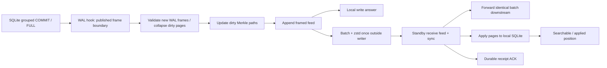

# WAL capture: architecture and recovery boundaries — 15 October 2026

Interim research before the performance round. The user authorized Rust in an
experimental product branch and research reports on research/main. This is an
experiment and a handoff for the Rust implementation, not a release promise.

| Question | Answer in this prototype | What follows |
|---|---|---|
| Where is the authoritative commit? | SQLite COMMIT with synchronous=FULL. The native WAL hook reports its last frame; capture completes under the same file writer, before answering callers. | One capture per SQLite group, including exclusive transactions and migrations. No SDK-level write wrapping. |
| Must every write pay another sync? | `LogFull` does. `WalGuarded` writes the feed but retains the already-durable native WAL until a coordinated feed sync and checkpoint. | Measure both against uncaptured writes and the previous scanner. |
| Can SQLite remove the recovery source early? | The hook replaces auto-checkpoint; NO_CKPT_ON_CLOSE prevents implicit close checkpoint. Controlled checkpoint first syncs the complete feed prefix. | External writers and external checkpoints are forbidden in this experiment. |
| What if capture fails after COMMIT? | That operation returns OutcomeUnknown; future writes stop before BEGIN. The WAL remains for reopen recovery. | Never acknowledge a missing feed entry as successful capture. |
| What is shipped? | Complete commits of changed WAL pages, final page count, sequence, predecessor and SHA-256 Merkle root. Pages repeated inside one commit are collapsed. | Cost depends on WAL dirtied pages, not all pages in the database. |
| How does a relay forward? | Sync the receive feed, forward the identical compressed batch, apply pages locally. | No recompression per child; durable receipt and searchable visibility are different milestones. |
| Does local FULL survive primary disk loss? | Only when an independent standby has durably received the acknowledged prefix. | Async ACK cannot promise this. Automatic election, fencing and remote ACK integration remain open. |

## Architecture

`WalGuarded` permits A after source FULL COMMIT and feed append, because the
original WAL remains durable. Every 256 KiB of dirty feed, or at 1024 WAL
frames, feed sync precedes a requested TRUNCATE checkpoint. A busy checkpoint
leaves the native WAL intact. Clean close also syncs feed before checkpoint.
`LogFull` adds feed sync before every A. Both modes must recover the same
acknowledged prefix under their stated filesystem assumptions.

The thread-local WAL callback records only a frame number and always succeeds.
Fallible I/O runs after SQLite COMMIT has returned, so a capture failure is
reported as an unknown outcome rather than pretending SQLite rolled back.
Source reopen validates journal records, replays remaining complete WAL commits,
compares the reconstructed root with a fresh SQLite snapshot, and syncs recovery
before accepting writes. Incomplete or invalid WAL tails never publish commits.
A mismatch fails closed; it does not silently replace missing history with a
new snapshot.

A receive ACK follows feed sync. A receiver that dies before page apply rebuilds
its SQLite file from the retained feed on reopen. Repeated identical sequence
numbers are idempotent; gaps and conflicting duplicates fail. The epoch is fixed
at 1; accepting a new primary requires a future external fencing protocol.

Page 1 excludes exactly offsets 24–27 and 92–95 from the canonical hash: SQLite
owns these two local change-counter copies. Geometry, page numbers and every
other page byte are covered. This is a new versioned format (`TSWAL002`,
`TSFEED02`, `TSBATCH2`, `TSROOT02`), incompatible with the earlier snapshot codec.

## Scope and limits

Single physical file per network pipeline; the source observer can register
multiple TinyStore files, but this round does not implement their catalog,
stream identities, retention, reconnect worker or promotion. The preceding
cascade prototype demonstrates that topology separately. No cross-file atomic
transaction or read-only policy for arbitrary product handles is implied.

The prototype bounds images at 16 MiB, feed at 256 MiB and decoded batches at
32 MiB / 1024 records. It keeps history in memory and has no compactor. Startup
is O(history + database size); the hot capture updates only dirty pages and
Merkle paths, with an occasional tree growth. Production needs budget accounting,
segmentation and persistent retention/snapshot boundaries.

Process exit without destructors, loss/truncation of unsynced feed bytes, and
primary-directory deletion after standby sync are reproducible fault models.
They are not power-cut tests. FULL relies on SQLite and the filesystem honoring
sync; device lies, media corruption and directory loss need separate tests.
The prototype is Linux-only; directory sync and file-sharing behavior have not
been ported or measured on macOS/Windows.

## Reproduction and next round

The experimental product seam is pinned at
`690cdf3` on `experiment/wal-capture`; the branch is not merged into the product.

The runnable harness is [wal-spike](../wal-spike/README.md); its source pin names
the isolated product commit. Frozen baseline code comes from research 4d95f68
(the earlier snapshot capture, with module paths and visibility changed only).
Run the bootstrap, tests and clippy before the release binary. The next dated
report will carry committed harness/source revisions, complete raw output,
three rotated passes, environment, per-object database bytes and limitations.

Network measurements compare persistent TCP echo with durable and applied ACKs,
one and three hops, batches of 1 and 32. The added 5 ms in each direction is
explicit application delay injection, not a geographically distributed network.
Batch creation is explicit in this harness; no hidden polling interval is
included and no automatic maximum batch wait has been implemented.
