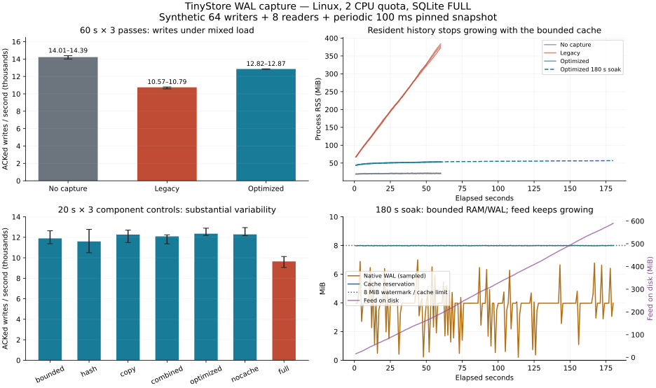
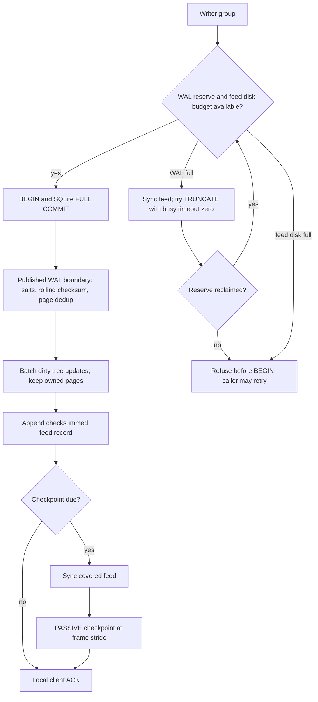

# Sustained WAL capture costs and bounds — 15 October 2026

The sustained mixed-load candidate raises acknowledged write throughput by
19.3–21.6% against its instrumented legacy control, retaining 89.5–91.8% of
the same-pass uncaptured write rate. The legacy control retains 75.0–75.6%.
The remaining loss is material. Capture is not free, and this is one small,
hot-write synthetic workload under CPU saturation.

The largest operational change is bounded history: process RSS falls from
373–384 MiB to 52–54 MiB across three 60-second passes. The cache reserves at
most 8 MiB per file; eviction drops RAM entries, leaving the complete feed on
disk. The feed disk guard eventually refuses writes because retention is not
implemented. Native WAL has admission and backpressure for the declared
transaction envelope, not a strict cap on arbitrary SQL.

| Question | Answer from this round | What follows |
| --- | --- | --- |
| Is the previous short write-only result enough? | No. This round uses 64 writers, eight readers, a periodically pinned snapshot, 60-second controls and a longer soak. | Keep mixed load and reader pressure as implementation gates. |
| Can resident history stay bounded? | Sequence/cursor no longer depend on resident packets; streaming recovery and bounded eviction preserve roots and acknowledged-write counts. | Share a global byte budget across files and the future sender. |
| Can copies and hashing be reduced without changing history? | Keep page ownership, pre-size encoding and hash common dirty ancestors once. Exact feed bytes and roots remain compatible. | Use the component measurements below to distinguish work saved from throughput gained. |
| Can checkpoint avoid waiting for a reader? | PASSIVE at frame strides, then a nonblocking TRUNCATE attempt at admission watermark. A pinned reader gets definite Unavailable before BEGIN. | Preserve safe retry, bounded retry rate and feed-sync-before-checkpoint ordering. |
| Is an arbitrary SQL transaction byte-bounded? | No. An over-reserve commit is already native-durable when observed; it returns OutcomeUnknown and poisons further writes until recovery. | An enforced transaction envelope or VFS-level pre-write admission is still required for a strict promise. |

This extends [the experiment plan](scaling-wal-load-design-2026-10-15.md).
It supersedes the short-load policy recommendation in the [preceding WAL
round](scaling-wal-2026-10-15.md); its numbers remain preserved. Snapshots,
segmented retention and a persistent sender remain later work.

## Environment and reproduction

- Product: `31b10e441a61f75171601c45111c20d8ba5b65d6`, branch
  `experiment/wal-load`, based on the preceding experimental WAL capture seam.
  It adds admission before BEGIN and a trusted checkpoint helper behind
  `capture-experiment`. It is not merged into the product Rust branch.
- Main and preflight harness: `b09de68cc6c1dd891a5bbc5ae2df39ec907893da`.
  Additional no-cache control, ablations, soak and diagnostics:
  `365437234ffd5e889de401552705b62bda332ca2`. Both were committed
  before their runs. The latter adds a mode/test; existing mode paths are
  unchanged. The old Go submodule and previous WAL module remain pinned.
- Managed Linux container, kernel 6.18.44, AMD EPYC 9V74, 3 visible CPUs,
  affinity 3, quota 2 CPUs, memory limit 8 GiB. Rust/cargo 1.99.0, Bun 1.4.2,
  bundled SQLite 3.53.2, rusqlite 0.40.2.
- Release build; DQS=0, dbpage verification, memory-management cache disabled,
  HAVE_FDATASYNC=1. Every mode uses the same binary and SQLite FULL. No build,
  test or lint overlaps the measured processes. The physical disk/controller
  behind the disk-backed overlayfs scratch is unknown.
- Synthetic fixture: 32768 rows, alternating 256-byte blobs; dbstat assigns
  8,974,336 bytes to `documents` and 4,096 to `sqlite_schema` (8,978,432 total).
  Blob payload bytes are 8,388,608; this round changes no schema or file occupancy.
  Tree storage is 262,144 bytes. Image maximum remains 16 MiB.
- Each case is a fresh process with two seconds of excluded warmup. Writers
  update 32 hot keys; readers range over the complete file, with one 128-row
  aggregate per 64 queries. A separate reader holds a snapshot for 100 ms,
  then waits two seconds before opening the next. There are 64 writer workers
  and eight ordinary reader workers, not a fixed read/write request ratio.
- All workers stop at the deadline and finish their in-flight operations;
  rates use actual elapsed time. Successful ACK counts must equal version
  increments, final canonical image must match the feed root, and SQLite
  integrity_check must pass. Refusals back off 1 ms and are counted separately.
- Fixed-size histograms use 1 us buckets below 4096 us, then 4096 us buckets;
  p95/p99 values are lower bucket bounds. Stage timers measure writer wall
  time, including descheduling, not isolated CPU. The process uses about two
  CPUs in these saturated mixed cases. Cgroup usage includes kernel file
  cache from earlier work; it must not be presented as capture RSS.

```sh
cd <repo>/tinystore/wal-load
./bootstrap.sh
cargo test --locked -- --test-threads=1
cargo clippy --all-targets --locked -- -D warnings
cargo build --release --locked
# No builds/tests/lint during these sequential prebuilt runs.
TMPDIR=<disk-backed-scratch> python3 run.py main <output>/main
TMPDIR=<disk-backed-scratch> python3 run.py ablation <output>/ablation
TMPDIR=<disk-backed-scratch> python3 run.py soak <output>/soak
python3 <data>/summarize.py
```

Run commands from the module directory so `.cargo/config.toml` supplies the
SQLite flags. `run.py` records process order/start/end/exit next to each JSONL.
Passes rotate mode order. Each table lists passes 1; 2; 3, not confidence
intervals. The 3-second preflight is calibration and is excluded from findings.

| Program | Start UTC, 15 October 2026 | End UTC | Cases |
| --- | --- | --- | --- |
| main | 14:54:01 | 15:03:21 | 9 × 60 s |
| ablation | 15:09:19 | 15:17:05 | 21 × 20 s |
| soak | 15:17:18 | 15:20:20 | 1 × 180 s |
| strace | 15:20:39 | 15:21:04 | 3 × 5 s diagnostic |



Bars show medians of three passes, whiskers their observed min/max. RSS lines
are sampled processes, with a separate 180-second optimized soak. The WAL
line is sampled; observer peaks are reported in the text. The feed uses the
right-hand axis. [PNG export](data/scaling-wal-load-2026-10-15/comparison.png).


Raw evidence: [initial environment](data/scaling-wal-load-2026-10-15/environment.json),
[follow-up environment](data/scaling-wal-load-2026-10-15/environment-followup.json),
[main](data/scaling-wal-load-2026-10-15/main/),
[ablations](data/scaling-wal-load-2026-10-15/ablation/),
[soak](data/scaling-wal-load-2026-10-15/soak/),
[derived ratios and normalized stages](data/scaling-wal-load-2026-10-15/derived.json).

## Capture and durability architecture



For the guarded local durability mode, at ACK the commit is in synced native
WAL and an appended feed record. Before any source-owned checkpoint can retire
that WAL, the covered feed is synced. Thus loss of an unsynced feed suffix can
be recovered from native WAL. This requires sole writer/checkpoint ownership;
external writers/checkpointers invalidate the contract. Independent primary
storage loss still needs a client ACK gated on an independent durable replica.
Nothing in this round implements that distributed ACK or promotion fencing.

The candidate changes four mechanisms: resident history becomes a byte-bounded
ring independent of cursor/sequence, dirty tree ancestors are deduplicated,
packet pages keep ownership while encoding into a pre-sized frame, and routine
checkpoint becomes PASSIVE with frame-stride retries. Hard-watermark admission
uses nonblocking TRUNCATE and safe refusal. The `legacy` control shares the
instrumentation, admission seam and 2 GiB disk guard, but retains whole history,
per-page ancestor walks, codec round-trip and routine TRUNCATE. It is not the
old report's binary.

## Sustained mixed-load comparison

| Mode | ACKed writes/s, passes 1; 2; 3 | Reads/s | Maximum sampled RSS, MiB |
| --- | --- | --- | --- |
| No capture | 14,225; 14,008; 14,389 | 341,385; 354,732; 348,538 | 21.48; 22.16; 22.07 |
| Legacy capture | 10,750; 10,572; 10,790 | 365,332; 352,545; 355,238 | 378.63; 373.31; 383.91 |
| Optimized capture | 12,823; 12,854; 12,873 | 366,737; 375,864; 363,926 | 53.57; 53.51; 52.45 |

The candidate/uncaptured write-rate ratios are 90.1%; 91.8%; 89.5%; the
candidate/legacy ratios are 119.3%; 121.6%; 119.3%. Sampled RSS is 7.0–7.3x
smaller. Reads and writes contend for the same CPU quota, so these are rates
at the given client concurrency, not a fixed-ratio workload or an isolated
write-CPU claim. Reporting only summed request rates would hide that trade.

Approximate successful-write p95 bucket bounds are 12.288; 12.288; 8.192 ms
without capture, 28.672 ms for all legacy passes, and 20.480; 20.480; 16.384 ms
for the candidate. Rejected admission attempts are excluded from this success
histogram; they are reported and the retry cost remains in achieved throughput.
There are 531; 1221; 502 refused operations against 769449; 771290; 772806
successful writes. One refused group can reject many operations.

The native WAL peak rises from 4,169,472 bytes to 7,350,112 bytes: bounded
backpressure replaces a smaller routinely truncated file. That is a deliberate
latency/space trade. It remains below the configured 8 MiB watermark in all
measured cases; the declaration that each group fits a 1 MiB frame reserve is
part of this workload's contract.

## Component controls

Three rotated 20-second passes use the same mixed load. `bounded` only evicts
resident history. `hash` adds batched ancestors to it; `copy` adds owned,
pre-sized encoding instead; `combined` adds both. All four retain routine
TRUNCATE. `optimized` changes checkpoint scheduling to nonblocking PASSIVE
with watermark admission. `nocache` removes the RAM ring; `full` adds feed
sync on every commit while preserving native FULL.

| Mode | ACKed writes/s, passes 1; 2; 3 | Reads/s | Maximum RSS, MiB |
| --- | --- | --- | --- |
| bounded | 11,368; 12,636; 11,891 | 354,497; 368,861; 367,675 | 54.62; 55.04; 54.82 |
| hash | 12,774; 11,597; 10,489 | 357,354; 346,931; 354,828 | 54.62; 54.94; 55.26 |
| copy | 12,264; 11,487; 12,705 | 358,544; 352,757; 380,969 | 50.12; 50.11; 50.26 |
| combined | 12,092; 11,366; 12,239 | 372,194; 360,867; 364,357 | 50.30; 50.16; 49.48 |
| optimized | 12,354; 12,889; 12,179 | 371,334; 372,335; 365,853 | 50.03; 50.39; 50.05 |
| nocache | 12,163; 12,283; 12,947 | 363,202; 356,471; 370,835 | 39.00; 37.91; 38.21 |
| full | 9,056; 9,644; 10,128 | 367,878; 367,653; 376,395 | 49.25; 49.34; 48.31 |

Work avoided is clearer than standalone throughput attribution:

| Stage, wall us per captured group | Control, passes 1; 2; 3 | Changed variant | Interpretation |
| --- | --- | --- | --- |
| Encoding | bounded: 18.57; 20.35; 18.51 | copy: 4.38; 3.95; 3.27 | 4.2–5.7x less encoding time; explicit codec payload copies fall from three to one. |
| Page/tree hashing | bounded: 19.21; 20.24; 16.20 | hash: 13.48; 15.87; 13.98 | 13.7–29.8% less measured tree time per group in this control; leaf SHA-256 remains. |
| Feed sync | optimized: 10.55; 9.58; 11.45 | full: 1335.14; 1217.18; 1107.02 | Amortized per captured group, not cost per sync syscall; full syncs every group. |

In the main runs, branch hashes per changed page fall from 12 to about 4.8
(about 60%). Encoding totals fall from 296–345 ms to 52–95 ms per minute.
Main candidate stage times per captured group are approximately 39–43 us WAL
read/checksum/page copy, 15–18 us tree hashing, 3–6 us encoding, 9–12 us feed
SHA, 19–22 us append, 12–14 us amortized feed sync and 4–7 us checkpoint.
Admission adds 20–25 us per captured group, including occasional watermark
checkpoint attempts. These wall timers include descheduling; capture encloses
several components and checkpoint can also occur inside admission, so summing
all reported timers double-counts work. Native SQLite commit/sync is outside
these capture timers and measured separately below.

The component write-rate effects change sign: `hash/bounded` is +12.4%;
−8.2%; −11.8%, `copy/bounded` +7.9%; −9.1%; +6.9%, and
`optimized/combined` +2.2%; +13.4%; −0.5%. These controls do not establish
independent throughput gains for hashing, copying or checkpoint; grouping,
reader competition and scheduling interact. They do establish less codec work,
fewer hashes, bounded resident history and nonblocking refusal. The main
60-second complete-candidate comparison repeats its gain in all three passes.

The per-commit feed-sync penalty repeats: −26.7%; −25.2%; −16.8% versus the
same-pass guarded candidate. No SQLite FULL sync was removed. This supports
preserving the guarded feed/native-WAL ordering rather than paying for two
independently synced local copies on every group, when the reliability mode
allows recovery from native WAL.

Removing the ring reduces RSS by another 11–12.5 MiB here. Its rate change is
−1.5%; −4.7%; +6.3%, with no stable speed benefit. It is a viable memory-first
policy while there is no sender, not evidence that a real sender should run
without a shared encoded-frame cache. Neither policy may keep the complete
history resident or give every child a decoded copy.

## Sync and checkpoint diagnostic

A separate 5-second mixed-load diagnostic traces only openat/fsync/fdatasync
with `strace -f -T -ttt -yy`, splitting descriptors by filename and cropping
between `timed-begin` and `timed-end` markers. It excludes seed, warmup and
close. The trace driver is committed at `400b859`; parser correction `61a3d47`
accepts whitespace in resumed calls and asserts feed counts against observer
counters. The measured binary
remains the `3654372` harness. Tracing changes scheduling and throughput, so
these syscall counts/times are diagnostics, not the untraced rates above.

| Mode | Native WAL sync count / summed wall ms | Feed sync count / summed wall ms | Main DB sync count / summed wall ms |
| --- | --- | --- | --- |
| legacy | 1009 / 793.377 | 2 / 4.745 | 2 / 1.002 |
| optimized | 1004 / 687.596 | 2 / 4.368 | 2 / 0.933 |
| full | 919 / 593.173 | 914 / 577.370 | 2 / 0.791 |

The feed count matches the observer's recorded sync count. Native WAL sync
includes FULL commit sync and header/checkpoint sync; it must not all be
labelled checkpoint cost. Main DB sync is from checkpoint. This separates
unavoidable source durability from feed duplication: per-group-feed-sync adds
hundreds of additional syncs here; routine feed sync/checkpoint is rare at this
fixture's write volume. These observations depend on this unknown backing
storage, build flags and the traced workload. They do not establish device
power-loss behavior or portable sync latency.

Reproduce after the untraced runs:

```sh
TMPDIR=<disk-backed-scratch> python3 <data>/trace.py
```

[Trace environment](data/scaling-wal-load-2026-10-15/environment-trace.json),
[raw traces and traced JSONL](data/scaling-wal-load-2026-10-15/trace/),
[parsed sync counts/times](data/scaling-wal-load-2026-10-15/trace/sync-derived.json).
The parser joins unfinished/resumed syscalls by thread before classifying them.

## Bounds, soak and recovery

A separate 180-second optimized soak finishes 2,358,498 successful writes
(13,102/s) and 65,762,583 reads (365,334/s). There are 3772 refused operations,
994 refused admission groups, 151 feed syncs and 1145 checkpoint attempts.
The root, ACK count and integrity check all pass. This is a three-minute run,
not an hours-long leak or endurance certification.

| Soak interval, seconds | Writes/s | Maximum sampled RSS, MiB | Feed size at end, MiB |
| --- | --- | --- | --- |
| 0–30 | 12,293 | 50.87 | 102.99 |
| 30–60 | 12,040 | 53.09 | 192.35 |
| 60–90 | 14,272 | 54.63 | 295.81 |
| 90–120 | 13,279 | 55.41 | 393.07 |
| 120–150 | 13,640 | 56.02 | 494.07 |
| 150–180 | 13,090 | 56.68 | 589.88 |

The final feed is 618,542,270 bytes (589.89 MiB), including seed and warmup;
window endpoints are the once-per-second samples before final drain. Native
WAL peak from the observer is 7,350,112 bytes (7.01 MiB); the cache reservation
never exceeds 8 MiB. RSS still rises slowly from roughly 51 to 57 MiB across
these windows, while whole-history residency is eliminated. Its final HWM is
57.32 MiB, including post-run verification. This is not proof of a whole-process
memory cap or a fully flat RSS plateau. Remaining native/allocator retention
needs a longer independent allocation-accounting experiment.

The cache charge includes encoded payload capacity, decoded page capacity and
conservative structure reservations; it is not a hook into the allocator. The
whole process also contains native SQLite caches, tree/scratch, workers and
transient bootstrap/recovery images. RSS is sampled once per second; the raw high-water mark also includes bootstrap
and final verification. Neither is an allocator-enforced cap. The per-file cap is not a global multi-database store budget.

Before BEGIN, admission reserves 1 MiB native WAL and twice that for feed
framing within a 2 GiB feed disk budget. A pinned reader prevents truncation;
the writer returns definite Unavailable, allowing retry after reader release.
No committed history is deleted to make room. Exceeding the declared frame
reserve is discovered after native COMMIT and returns OutcomeUnknown, then
refuses subsequent writes until reopen/recovery. This is not a strict generic
SQL WAL/disk cap. SQLite can overwrite uncommitted frames in one transaction;
repeated UPDATE statements alone do not establish worst-case WAL growth. A
production promise needs an enforceable transaction contract or VFS admission,
including spill, savepoints, FULL padding and external-access rules.

Eight parent research tests pass, including 16 deterministic abrupt workers
across legacy, optimized and per-group-feed-sync modes, checkpoint boundaries,
post-commit/pre-append and post-ACK death. The new suite also checks bounded
recovery without a cached seed, zero-cache recovery, exact feed byte equality,
tree growth/shrink equivalence, definite refusal/resume with a pinned reader,
disk refusal before mutation and oversized-commit recovery. These controlled
process exits and the earlier fault models are not real power-cut certification.
All measured cases check ACK counts, canonical roots and SQLite integrity.

## Implementation handoff

Keep the committed product seam on its experimental branch. The research
candidate preserves TSFEED02/TSWAL002/TSROOT02 bytes; it needs no second write
log before SQLite COMMIT, no unbounded in-memory queue and no SQL-level change
capture. The remaining bottlenecks and bounds should guide the next work:

1. Define enforceable per-transaction/native memory admission and a global
   multi-file budget before promising arbitrary-SQL hard limits.
2. Carry forward owned immutable frames; a sender should share them among
   children with bounded byte/time batching and stream-position ACKs. Avoid
   retaining a second decoded copy per child. Keep apply outside forwarding.
3. Add snapshots with atomic snapshot/stream position, then segmented retention
   and slow-child snapshot fallback. A full feed replay is still required at
   startup, and finite disk budget currently stops writes rather than deleting
   history.
4. Build the persistent sender and repeat the 140-child/cascade/WAN controls.
   This load round does not remeasure end-to-end propagation or claim a new
   network-floor result.

[Verification and CI limits](data/scaling-wal-load-2026-10-15/verification.md)
are part of the result. Local core/SDK checks pass; product CI still has an
unresolved SDK events teardown failure, so the product branch is not fully green.
